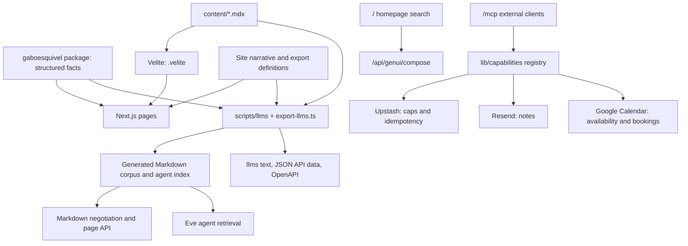

# Architecture

This document maps the implemented system and its ownership boundaries. Read it before changing data flow, integrations, build outputs, or the relationship between the website and its agent. Product intent lives in [PRODUCT.md](PRODUCT.md), visual and interaction decisions in [DESIGN.md](DESIGN.md), and development setup in [README.md](README.md). Procedures are linked from [AGENTS.md](AGENTS.md).

## System overview

The site is a Next.js App Router application with three connected surfaces: a portfolio and publishing site, machine-readable representations of its content, and an Eve agent for questions, notes, and scheduling. React renders the interface; Bun runs development, generation, and checks. Vercel hosts the application and Eve service. Exact dependency versions and executable commands belong to [package.json](package.json) and the lockfile.

## Sources of truth

| Owner | Owns | Consumers |
| --- | --- | --- |
| External `gaboesquivel` package | Project, technology, employment, and CV variant facts | Pages, cards, CVs, exports, agent context |
| `app/` and shared components | Site narrative, route composition, metadata, presentation | Human-facing pages |
| `content/*.mdx` | Blog source and frontmatter | Velite rendering and Markdown exports |
| `scripts/llms/` | Machine-readable narrative, route mapping, authority order, corpus assembly | Text exports, Markdown responses, API data, agent retrieval |
| `agent/` and `lib/connect/` | Eve configuration, retrieval, and connect-domain helpers | Eve channels and generative compose paths |
| `lib/capabilities/` and `app/mcp/` | Public capability registry and MCP HTTP transport | External MCP clients and `/api/capabilities` |
| Installed `gabo` skill | Voice, identity, and claim constraints | Content authoring; maintenance is in [docs/agents/skills.md](docs/agents/skills.md) |

The site does not own a second copy of package facts. Package changes follow [docs/agents/package.md](docs/agents/package.md). A local link makes unpublished package changes visible during development; production still installs the published dependency. `next.config.js` detects the link and adjusts transpilation and file tracing.

The HTML narrative and its machine-readable representation share facts but include separately maintained prose and mappings. Changing a page does not automatically update every export. Use [docs/agents/propagation.md](docs/agents/propagation.md) when a route, identity fact, or featured project changes.

## Code boundaries

| Area | Responsibility and entry points |
| --- | --- |
| `app/` | Route composition, metadata, layouts, error pages, and HTTP handlers. `app/layout.tsx` provides the shared shell. |
| `components/shared/`, `components/layout/`, `components/ui/` | Reusable page primitives, layout, and controls. DESIGN.md identifies the owning tokens and components. |
| `components/work/`, `components/blog/`, `components/mdx.tsx` | Project evidence, post listings, and compiled MDX rendering. |
| `lib/blog*`, `lib/tech-evidence.ts`, `lib/work-types.ts` | Content selection, taxonomy, related posts, and evidence filtering. |
| `lib/api/`, `lib/accept-markdown.ts`, `lib/markdown-*` | Public read contracts, content negotiation, canonicalization, and error responses. |
| `app/connect/` | Contact and booking card UI. `/ask` does not mount it; that route redirects to `/`. |
| `agent/` | Eve model, channels, instructions, retrieval hooks, tools, and runtime skills. |
| `lib/connect/` | Shared contact-domain logic: schemas, intent, retrieval ranking, caps, CV cards, notes, and bookings. |
| `lib/mcp/`, `app/mcp/cv/` | Dedicated MCP CV app and download widget. |
| `scripts/` | Content/API export, CV printing, verification, and operational helpers. |

Coding-agent skills in `.agents/skills/` guide repository work. The skills in `agent/skills/` belong to the application's Eve runtime. Their consumers and installation paths are different; changing development guidance does not require changing the runtime agent.

## Design System v2 presentation

`components/layout/site-width.tsx` applies the homepage `max-w-6xl` shell on every route. `app/page.tsx` remains a Server Component reading package projects and Velite posts, wrapped by `HomepageGenUiShell` for generative search. The OpenUI renderer loads only after submit via `/api/genui/compose`; first paint does not initialize Eve, MCP, or the renderer. Public reads and writes flow through `lib/capabilities/` and `/api/capabilities`. `/mcp` is served by `app/mcp/route.ts` (nine registry tools); Eve no longer intercepts that path. `/ask` redirects to `/`.

`lib/work/project-cover.ts` holds homepage selected-work slugs, `resolveProjectImage` (package `image` URLs made site-relative via `lib/site-path.ts`), and shared `sizes` strings; project image paths stay in the package. `EditorialProjectCard` and `EditorialProjectList` are Server Components. The list receives resolved project records and does not call `getProjectBySlug`. `lib/genui/contract/` is the shared OpenUI compiler (schemas, parser validation, record grounding, composite allowlists). `lib/genui/experience-contract.ts` retains lightweight prop policy helpers. `ExperienceStack` composes a bounded list of validated child experiences (no nested stacks); the shared compiler validates each subtree and the renderer maps children to the same experience views as single-intent results. Automated quality layers, fixture lab, and MCP Apps harness are documented in [docs/testing/README.md](docs/testing/README.md). The homepage portrait ships as `public/images/gabo-portrait.webp`, separate from the existing OG master. Project hero/OG sources are unchanged.

## Content and build flow

`velite.config.ts` defines the blog schema. Velite compiles `content/*.mdx` into `.velite`, validating technology tags against the package and categories against `lib/blog-taxonomy.ts`. `lib/blog.ts` exposes this compiled collection; blog routes render it through `components/mdx.tsx`.

`bun run build` runs Velite, then `scripts/export-llms.ts`, then Next.js. The export assembles package facts, blog content, and site-specific definitions into:

- `public/llms.txt` and `public/llms-full.txt`;
- `generated/markdown-routes.json`, keyed by page path and supported query variants;
- `generated/agent-index.json`, the agent's retrieval index;
- `generated/api/profile.json` and `generated/api/pages.json`;
- `public/openapi.json`, generated from `lib/api/openapi.ts`.

These outputs are ignored build artifacts. Change their sources and regenerate them. The full llms corpus excludes pre-2020 posts by product policy; that does not remove the historical posts from the site.

Development runs the export once at startup, alongside a continuing Velite watcher and Next.js server. The export is not itself watched: rerun `bun run export:llms` after changing its inputs when checking Markdown, API, or retrieval behavior. `next.config.js` includes generated files in the relevant deployment traces.

## Public representations and routing

HTML routes live in `app/`; PRODUCT.md owns their jobs and discoverability. Dynamic project, technology, and blog routes derive their evidence from package or content data. Navigation, sitemap, discovery pages, and export route definitions are separate consumers, not one inferred sitemap.

Default personal social images use `app/opengraph-image.png` (the homepage portrait and its linework from `lib/portrait-overlay.ts`) and the same bytes at `/og` (`app/og/route.ts`). Homepage, About, and CV point Open Graph and Twitter images at `/og`. Blog posts use build-time editorial OG images at `public/images/og/blog/{slug}.png` (title and `summary`; optional frontmatter `ogImage` overrides). Project routes use OG derivatives from each project hero at `public/images/og/projects/{slug}.png`, falling back to `/og` when no hero exists. Hero delivery uses optimized mobile and desktop WebPs (`bun run hero:optimize` from `assets/homepage/gaboesquivel-homepage-master.webp`). Generation is documented in [docs/agents/images.md](docs/agents/images.md) and implemented in `scripts/generate-og.ts` with shared layout in `lib/og/`.

`proxy.ts` negotiates public page representations. Requests preferring `text/markdown`, and explicit `.md` siblings, rewrite to `app/api/markdown/[[...slug]]/route.ts`. That handler reads the generated corpus, preserves supported query variants, and returns a Markdown 404 for missing entries. HTML responses advertise Markdown alternates; negotiation varies on `Accept`.

The read-only JSON surface is `/api/v1/profile`, `/api/v1/pages`, and `/api/v1/pages/[...path]`. Its contract lives in `lib/api/openapi.ts`, with response and error helpers in `lib/api/`. `/openapi.json` exposes the generated specification. `app/api/[[...slug]]/route.ts` handles unknown API routes; it is not the Eve transport.

`next.config.js` owns permanent redirects, optional Edge Config redirects, security headers, and Eve integration. If Edge Config cannot be read, the built-in redirects remain available. `/connect` redirects to `/contact`; `/cal` redirects to the external scheduling fallback.

## Agent and action flow

`/ask` redirects to `/` (`app/ask/page.tsx` and a non-permanent redirect in `next.config.js`). The nav sheet still links to `/ask`, so that link currently lands on the homepage. Homepage and dialog search submit to `/api/genui/compose`. `next.config.js` still wraps the Next config with `withEve`; that wrapper is not the public tool list.

`app/mcp/route.ts` serves the capability registry in `lib/capabilities/registry.ts`: `book_call`, `contact_gabo`, `get_cv`, `get_profile`, `list_availability`, `list_projects`, `list_writing`, `search_site`, and `send_note`. `/mcp/cv` remains the CV download app. `/docs` is the integration page. The llms export still contains older `/ask` agent wording; the route behavior above is the source of truth until that export is revised.

`agent/agent.ts` configures the model and disables default tools. Application tools and channels are defined under `agent/`. Live inference uses `lib/ai/resolve-chat-model.ts`: `AI_GATEWAY_API_KEY` is the normal path; direct Anthropic requires `FLOW_ALLOW_DIRECT_ANTHROPIC=1` with `ANTHROPIC_API_KEY`.

Retrieval uses `generated/agent-index.json` and `generated/markdown-routes.json`, with selection and ranking logic in the agent hooks and `lib/connect/`. This is generated corpus retrieval, not a vector database. Changes to facts or exports must reach these artifacts before the agent can use them.

The connect UI in `app/connect/` can display a CV download card, project media, a note form, and a booking flow. It is not mounted at `/ask`. The note opener is handled by the UI; `NOTE_FORM_LEAD` owns the form introduction. While the form is visible, the thread suppresses the replying indicator. Preserve this boundary when changing conversational behavior.

The booking picker combines real availability with deterministic React UI in `app/connect/slot-picker.tsx`. `list_slots` returns structured `slotState` for the picker; server-side booking logic owns validation and the Calendar write. A generated UI payload is not authorization to perform an action.

External agents call the capability registry at `/mcp`. `/mcp/cv` is a separate Next.js handler for the CV app/widget. The integration page is `/docs`.

## State, credentials, and external effects

The portfolio's durable content is repository files and the published package. Eve manages conversation/session behavior; `lib/connect/store.ts` does not implement a conversation database. Browser session handling is in `app/connect/session-cookie.ts`.

Upstash Redis stores action caps and idempotency state through `lib/connect/store.ts` and `caps.ts`. These records expire. Local development can use an in-memory store; Vercel Production and Preview require configured Redis for these controls. Local daily caps are skipped unless explicitly enabled for testing. Provisioning and environment names are in [docs/agents/ask.md](docs/agents/ask.md).

| Integration | Boundary |
| --- | --- |
| AI Gateway and Anthropic | Server-side model access via `AI_GATEWAY_API_KEY`; optional direct Anthropic with `FLOW_ALLOW_DIRECT_ANTHROPIC=1`. |
| Resend | Notes are delivered through `lib/connect/email.ts` and `note.ts`; delivery is an external side effect. |
| Google Calendar | `calendar-auth.ts` signs service-account JWTs with domain-wide delegation. `calendar.ts` reads availability and `book.ts` coordinates booking. The service account impersonates the explicitly configured calendar identity; `calendarId()` rejects an absent or blank value. Visitors do not complete OAuth. |
| Upstash | Distributed caps and duplicate-action coordination, not portfolio content storage. |
| Vercel Edge Config | Optional additional redirects at configuration time. |
| Vercel Analytics | Browser analytics loaded through `components/layout/deferred-analytics.tsx`. |

Treat chat text, MCP inputs, form fields, and model output as untrusted input. Tool schemas, approval handling, and domain checks mediate actions. Browser bookings require Eve approval; structured note-form submissions bypass an additional approval, and MCP calls do not use browser approval. Inspect the owning tool and domain helper together when changing a write operation; a UI-only check cannot protect the MCP path. Keep credentials server-side and use the documented configuration procedure without copying values into documentation.

Booking rechecks availability before inserting an event and uses Redis to coordinate duplicate requests. Redis and Google Calendar do not share a transaction, so these guards do not establish an exactly-once or collision-free guarantee.

## CV and print outputs

The package owns CV content and variants. `lib/cv-paths.ts` owns PDF filenames and section titles; `app/cv/page-breaks.ts` holds measured print breaks; `app/cv/` owns rendering and print layout. `scripts/export-cv.ts` prints with local Chrome through `playwright-core`, computes page breaks, and writes PDFs plus supporting print artifacts. This use of Playwright is a PDF export implementation, separate from interactive browser verification.

`bun run cvs` regenerates CV outputs; run it and commit them after changing CV, global stylesheet, or contact-info sources ([checks](docs/agents/checks.md)). Changes to package facts still belong in the package repository even when they affect the rendered CV.

## Maintaining this map

Update this document when source ownership, system boundaries, data flow, or integrations change. Keep product decisions in [PRODUCT.md](PRODUCT.md), visual decisions in [DESIGN.md](DESIGN.md), and setup in [README.md](README.md).

### GenUI planning and composition

A request becomes an ordered task plan (`lib/genui/task-plan.ts`). Stable ids are `task-1`, `task-2`, so two project filters stay two obligations. Simple curated and single-intent requests stay on the existing deterministic route and do not call a model. Complex requests may use one schema-validated planner call (`lib/genui/semantic-plan.ts`, AI SDK `generateText` with `Output.object`). The model selects operations and constraints. `lib/genui/catalog-operation.ts` executes counts, filters, exclusions, deduplication, and limits on the published portfolio before any prompt truncation.

Composition uses approved experiences and `ExperienceStack` (`lib/genui/compose-planned.ts`). Relationships are explanation plus evidence, comparison plus a supported interpretation, primary content plus a filter note, evidence plus a requested action, chronology, and a short factual answer. Component rules live in `lib/genui/component-semantics.ts`.

Requested comparison dimensions travel as a `ProjectExperience` `dimensions` prop (`lib/genui/comparison-dimensions.ts`); process questions about building with agents compose an answer plus `WritingExperience` from topic-ranked published posts (`lib/genui/writing-topic.ts`). Homepage and the search dialog wrap generated results in the same `GenuiSessionProvider` (draft and interaction state), and `GeneratedRegion` turns render or contract failures into a retryable error.

Coverage is per task. Recovery (`lib/genui/recover-composition.ts`) keeps valid sections, fills a missing supported task without broadening its filter, and does not call the model again. A cancelled request does not emit a completion or error over a newer result.

Budgets: planner 3.5s and 1,200 output tokens; composition 12s and 4,000 output tokens; HTTP deadline 15s; at most two model calls; evidence packet 12 records and 28,000 characters, without the full catalog listing; at most six stack children. Counts are published portfolio records. Structural coverage does not prove a sentence is entailed by its sources. See [docs/adr/ADR-genui-task-planning.md](docs/adr/ADR-genui-task-planning.md).

### GenUI career chronology

`TimelineExperience("chapter-stack", "/bio", projectIds)` is registered in both OpenUI libraries and validated by the shared compiler. The biography profile and every referenced project must be present in the envelope. `timelineDocument` binds package projects to canonical chapter data in `lib/bio/chapters.ts` (GenUI summaries re-exported from `lib/bio/career-timeline.ts`). `/bio` and `TimelineExperience` both render the shared `BioTimeline` composite in `components/bio/bio-timeline.tsx`; project descriptions and cover paths remain package-owned. Explicit career-story prompts select this composition deterministically before semantic synthesis. The same renderer serves homepage and MCP Apps; the fixture is `career-timeline`. Other experience questions retain the existing evidence-answer path.
