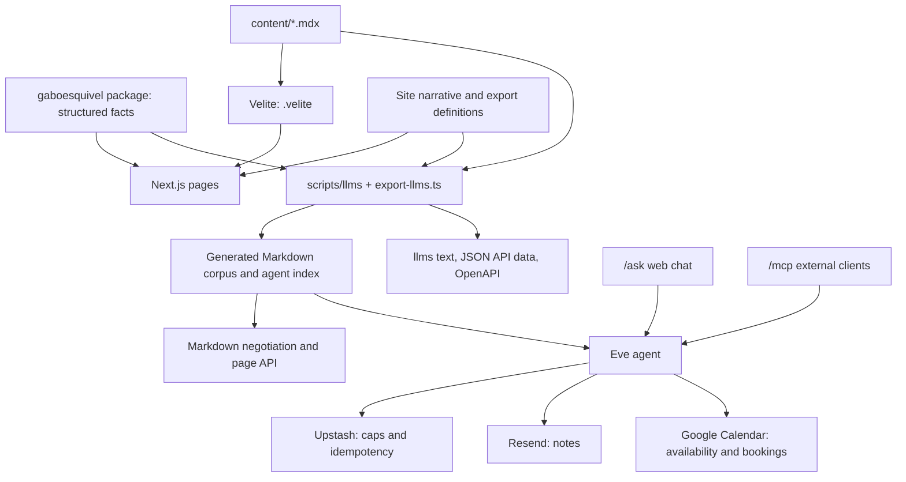

# Architecture

This document maps the implemented system and its ownership boundaries. Read it before changing data flow, integrations, build outputs, or the relationship between the website and its agent. Product intent lives in [PRODUCT.md](PRODUCT.md), visual and interaction decisions in [DESIGN.md](DESIGN.md), and development setup in [README.md](README.md). Procedures are linked from [AGENTS.md](AGENTS.md).

## System overview

The site is a Next.js App Router application with three connected surfaces: a portfolio and publishing site, machine-readable representations of its content, and an Eve agent for questions, notes, and scheduling. React renders the interface; Bun runs development, generation, and checks. Vercel hosts the application and Eve service. Exact dependency versions and executable commands belong to [package.json](package.json) and the lockfile.

## Sources of truth

| Owner | Owns | Consumers |
| --- | --- | --- |
| External `gaboesquivel` package | Project, technology, employment, and CV variant facts | Pages, cards, CVs, exports, agent context |
| `app/` and shared components | Site narrative, route composition, metadata, presentation | Human-facing pages |
| `content/*.mdx` | Blog source and frontmatter | Velite rendering and Markdown exports |
| `scripts/llms/` | Machine-readable narrative, route mapping, authority order, corpus assembly | Text exports, Markdown responses, API data, agent retrieval |
| `agent/` and `lib/connect/` | Agent configuration, tools, retrieval, contact and scheduling behavior | Web chat and MCP |
| Installed `gabo` skill | Voice, identity, and claim constraints | Content authoring; maintenance is in [docs/agents/skills.md](docs/agents/skills.md) |

The site does not own a second copy of package facts. Package changes follow [docs/agents/package.md](docs/agents/package.md). A local link makes unpublished package changes visible during development; production still installs the published dependency. `next.config.js` detects the link and adjusts transpilation and file tracing.

The HTML narrative and its machine-readable representation share facts but include separately maintained prose and mappings. Changing a page does not automatically update every export. Use [docs/agents/propagation.md](docs/agents/propagation.md) when a route, identity fact, or featured project changes.

## Code boundaries

| Area | Responsibility and entry points |
| --- | --- |
| `app/` | Route composition, metadata, layouts, error pages, and HTTP handlers. `app/layout.tsx` provides the shared shell. |
| `components/shared/`, `components/layout/`, `components/ui/` | Reusable page primitives, layout, and controls. DESIGN.md identifies the owning tokens and components. |
| `components/work/`, `components/blog/`, `components/mdx.tsx` | Project evidence, post listings, and compiled MDX rendering. |
| `lib/blog*`, `lib/tech-evidence.ts`, `lib/work-types.ts` | Content selection, taxonomy, related posts, and evidence filtering. |
| `lib/api/`, `lib/accept-markdown.ts`, `lib/markdown-*` | Public read contracts, content negotiation, canonicalization, and error responses. |
| `app/connect/` | Client chat and forms used by `/ask`; the folder name persists after the public route rename. |
| `agent/` | Eve model, channels, instructions, retrieval hooks, tools, and runtime skills. |
| `lib/connect/` | Shared contact-domain logic: schemas, intent, retrieval ranking, caps, CV cards, notes, and bookings. |
| `lib/mcp/`, `app/mcp/cv/` | Dedicated MCP CV app and download widget. |
| `scripts/` | Content/API export, CV printing, verification, and operational helpers. |

Coding-agent skills in `.agents/skills/` guide repository work. The skills in `agent/skills/` belong to the application's Eve runtime. Their consumers and installation paths are different; changing development guidance does not require changing the runtime agent.

## Content and build flow

`velite.config.ts` defines the blog schema. Velite compiles `content/*.mdx` into `.velite`, validating technology tags against the package and categories against `lib/blog-taxonomy.ts`. `lib/blog.ts` exposes this compiled collection; blog routes render it through `components/mdx.tsx`.

`bun run build` runs Velite, then `scripts/export-llms.ts`, then Next.js. The export assembles package facts, blog content, and site-specific definitions into:

- `public/llms.txt` and `public/llms-full.txt`;
- `generated/markdown-routes.json`, keyed by page path and supported query variants;
- `generated/agent-index.json`, the agent's retrieval index;
- `generated/api/profile.json` and `generated/api/pages.json`;
- `public/openapi.json`, generated from `lib/api/openapi.ts`.

These outputs are ignored build artifacts. Change their sources and regenerate them. The full llms corpus excludes pre-2020 posts by product policy; that does not remove the historical posts from the site.

Development runs the export once at startup, alongside a continuing Velite watcher and Next.js server. The export is not itself watched: rerun `bun run export:llms` after changing its inputs when checking Markdown, API, or retrieval behavior. `next.config.js` includes generated files in the relevant deployment traces.

## Public representations and routing

HTML routes live in `app/`; PRODUCT.md owns their jobs and discoverability. Dynamic project, technology, and blog routes derive their evidence from package or content data. Navigation, sitemap, discovery pages, and export route definitions are separate consumers, not one inferred sitemap.

Default social images use `app/opengraph-image.png` (file-based Open Graph metadata) and the same bytes at `/og` (`app/og/route.ts`). Project routes and blog posts with optional frontmatter `image` override with their own hero or project artwork; posts without `image` keep the site default. Generation is documented in [docs/agents/images.md](docs/agents/images.md).

`proxy.ts` negotiates public page representations. Requests preferring `text/markdown`, and explicit `.md` siblings, rewrite to `app/api/markdown/[[...slug]]/route.ts`. That handler reads the generated corpus, preserves supported query variants, and returns a Markdown 404 for missing entries. HTML responses advertise Markdown alternates; negotiation varies on `Accept`.

The read-only JSON surface is `/api/v1/profile`, `/api/v1/pages`, and `/api/v1/pages/[...path]`. Its contract lives in `lib/api/openapi.ts`, with response and error helpers in `lib/api/`. `/openapi.json` exposes the generated specification. `app/api/[[...slug]]/route.ts` handles unknown API routes; it is not the Eve transport.

`next.config.js` owns permanent redirects, optional Edge Config redirects, security headers, and Eve integration. If Edge Config cannot be read, the built-in redirects remain available. `/connect` redirects to `/contact`; `/cal` redirects to the external scheduling fallback.

## Agent and action flow

`app/ask/page.tsx` mounts the chat from `app/connect/`. `connect-chat.tsx` and `eve-thread.tsx` coordinate the conversation, approvals, forms, and cards. Eve's Next.js integration supplies the transport through `withEve` in `next.config.js`.

`agent/agent.ts` configures the model and disables default tools. Application tools and channels are defined under `agent/`. `lib/connect/sonnet-model.ts` configures Sonnet with Anthropic BYOK on the gateway. Gateway authentication and Anthropic provider authentication use distinct credentials.

Retrieval uses `generated/agent-index.json` and `generated/markdown-routes.json`, with selection and ranking logic in the agent hooks and `lib/connect/`. This is generated corpus retrieval, not a vector database. Changes to facts or exports must reach these artifacts before the agent can use them.

The chat can display a CV download card, project media, a note form, and a booking flow. The note opener is handled by the UI; `NOTE_FORM_LEAD` owns the form introduction. While the form is visible, the thread suppresses the replying indicator. Preserve this boundary when changing conversational behavior.

The booking picker combines real availability with a bounded json-render component catalog. `lib/connect/compose.ts` supports Jev composition and a deterministic layout when layout is forced, credentials are absent, or composition fails. The current slot-listing path resolves a duration and uses the forced layout. Server-side booking logic owns validation and the Calendar write. A generated UI specification is not authorization to perform an action.

External agents use the Eve MCP channel at `/mcp`, with `agent_start` and `agent_get`. `next.config.js` explicitly attaches this path to Eve through local rewrites and a Vercel output routing patch. `/mcp/cv` is a separate Next.js handler for the CV app/widget. The integration instructions presented to callers live at `/docs`.

## State, credentials, and external effects

The portfolio's durable content is repository files and the published package. Eve manages conversation/session behavior; `lib/connect/store.ts` does not implement a conversation database. Browser session handling is in `app/connect/session-cookie.ts`.

Upstash Redis stores action caps and idempotency state through `lib/connect/store.ts` and `caps.ts`. These records expire. Local development can use an in-memory store; Vercel Production and Preview require configured Redis for these controls. Local daily caps are skipped unless explicitly enabled for testing. Provisioning and environment names are in [docs/agents/ask.md](docs/agents/ask.md).

| Integration | Boundary |
| --- | --- |
| AI Gateway and Anthropic | Server-side model access; `AI_GATEWAY_API_KEY` and `ANTHROPIC_API_KEY` have separate roles. |
| Resend | Notes are delivered through `lib/connect/email.ts` and `note.ts`; delivery is an external side effect. |
| Google Calendar | `calendar-auth.ts` signs service-account JWTs with domain-wide delegation. `calendar.ts` reads availability and `book.ts` coordinates booking. The service account impersonates the explicitly configured calendar identity; `calendarId()` rejects an absent or blank value. Visitors do not complete OAuth. |
| Upstash | Distributed caps and duplicate-action coordination, not portfolio content storage. |
| Vercel Edge Config | Optional additional redirects at configuration time. |
| Vercel Analytics | Browser analytics loaded through `components/layout/deferred-analytics.tsx`. |

Treat chat text, MCP inputs, form fields, and model output as untrusted input. Tool schemas, approval handling, and domain checks mediate actions. Browser bookings require Eve approval; structured note-form submissions bypass an additional approval, and MCP calls do not use browser approval. Inspect the owning tool and domain helper together when changing a write operation; a UI-only check cannot protect the MCP path. Keep credentials server-side and use the documented configuration procedure without copying values into documentation.

Booking rechecks availability before inserting an event and uses Redis to coordinate duplicate requests. Redis and Google Calendar do not share a transaction, so these guards do not establish an exactly-once or collision-free guarantee.

## CV and print outputs

The package owns CV content and variants. `app/cv/variants.ts` adds site PDF paths and print metadata; `app/cv/` owns rendering and print layout. `scripts/export-cv.ts` prints with local Chrome through `playwright-core`, computes page breaks, and writes PDFs plus supporting print artifacts. This use of Playwright is a PDF export implementation, separate from interactive browser verification.

The pre-commit hook regenerates and stages CV outputs when the specified CV, global stylesheet, or contact-info sources are staged. See `scripts/hooks/cvs-if-needed.sh` for the trigger paths. Changes to package facts still belong in the package repository even when they affect the rendered CV.

## Maintaining this map

Update this document when source ownership, system boundaries, data flow, or integrations change. Keep product decisions in [PRODUCT.md](PRODUCT.md), visual decisions in [DESIGN.md](DESIGN.md), and setup in [README.md](README.md).
