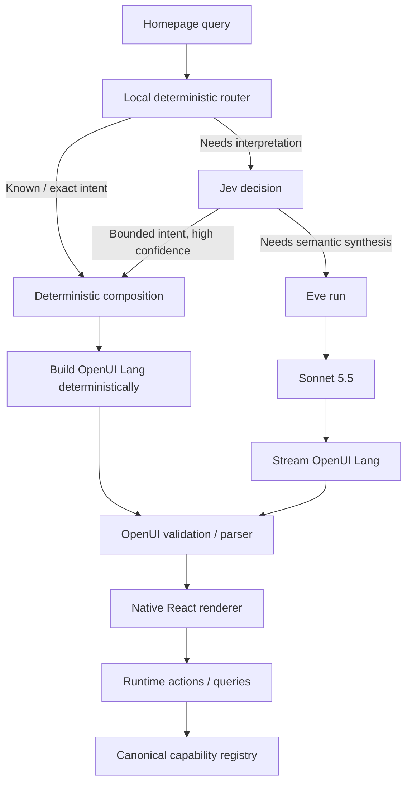
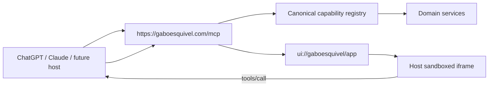

> **Background only.** Current homepage direction is in [PRODUCT.md](../../PRODUCT.md) (`/`) and [DESIGN.md](../../DESIGN.md). Executable specs live under [docs/specs/homepage-genui/](../specs/homepage-genui/).

# Generative Homepage and MCP App — Architecture Spec Draft

## Architectural decisions

The direction is sound, but I would change one important premise from the earlier `/idea` document:

**Use OpenUI Lang, but not because ChatGPT, Claude, or future agents understand OpenUI Lang. They do not need to. MCP Apps is the interoperability layer. OpenUI is the shared declarative UI representation and runtime inside your website and inside the MCP App view.**

That distinction matters. MCP Apps defines how an MCP tool points to a `ui://` resource, how a compatible host renders that resource in a sandboxed iframe, and how the view exchanges data and tool calls with the host. ChatGPT explicitly implements that open MCP Apps model, and MCP Apps supports host context including dimensions, mobile/desktop platform, theme, locale, and display mode. citeturn10search19turn10search16turn13search0 OpenAI likewise recommends the standard `_meta.ui.resourceUri` mechanism and says the component runs inside an iframe **in ChatGPT**, not that your own website needs an iframe. citeturn13search12turn13search14

So the target should be:

| Concern | Technology | Decision |
| --- | --- | --- |
| Native homepage UI | React + OpenUI Lang | **Yes** |
| Generated representation | OpenUI Lang | **Yes** |
| Responsive component catalog | Your React/shadcn/Base UI design system wrapped as OpenUI components | **Yes** |
| Website agent runtime | Eve | **Yes** |
| General semantic reasoning | Claude Sonnet 5.5 through AI Gateway | **Yes, only when needed** |
| Fast classification/routing | Jev 1.14 | **Yes, as decision plane, not UI composer** |
| External agent protocol | MCP | **Yes** |
| External interactive UI | MCP Apps | **Yes** |
| Iframe on gaboesquivel.com | None | **No** |
| Iframe in ChatGPT/Claude MCP hosts | MCP Apps host responsibility | **Yes, expected** |
| JSON Render | Remove | **Yes** |
| `/ask` compatibility during migration | Not a constraint | **Can break/redirect temporarily** |
| Generated-document caching | None | **No** |
| Redis as a composition cache | None | **No** |
| First-load model call | None | **Absolutely not** |
| LLM call for every search | None | **No** |
| Subagents | None for this feature | **Not in MVP** |

This is also much closer to the separation already identified in your research: capability protocol, composition semantics, generated representation, native rendering, runtime state, and action authorization are separate layers rather than one monolithic “generative UI stack.” fileciteturn0file0

I would therefore **replace the earlier “select → compile everything” idea with a three-tier composition architecture**:

> **deterministic route → Jev decision route → Eve/Sonnet generative route**

OpenUI is the output language across those paths. MCP Apps is the external delivery protocol.

That gives you deterministic speed where possible, Jev's leverage where classification is enough, and Sonnet's reasoning only where actual synthesis is valuable.

One other immediate cleanup follows from this decision. The repository currently contains `@json-render/core` and `@json-render/react`, alongside Eve, AI SDK 7, the MCP SDK, Next 16, React 19 and Base UI. fileciteturn1file0L1-L13 The Eve runtime also currently contains two JSON Render-specific skills: `core`, whose description explicitly says it teaches `@json-render/core` and Jev's experimental JSON Render composer, and `react`, which explicitly teaches the `@json-render/react` renderer. fileciteturn18file0L1-L10 fileciteturn19file0L1-L10 Those should disappear with JSON Render rather than remaining as competing instructions.

## Product and interaction specification

The homepage should remain a **real homepage first and a generative interface second**. The AI feature must not degrade the experience of someone who simply loads the site and scrolls.

Today, `/` server-renders Gabo's title, hero image and introduction, then Selected Work, Focus, Career, Writing and Work Together, with a “Contact me” link inside the hero. fileciteturn12file0 That is the correct first-paint foundation.

**Initial state.** Replace the current “Contact me” action with the prompt/search form. Everything else renders exactly as ordinary server-rendered homepage content. No Eve session, Jev request, Sonnet request, MCP connection, OpenUI renderer, or MCP App JavaScript should be needed to produce the first meaningful paint.

The field should feel like part of the portfolio rather than a chatbot composer. There is no visible send button. `Enter` submits; on mobile, the keyboard action should behave as search/submit. Suggested prompts can communicate what is possible without turning the page into a chat transcript.

**On first submission.** The UI should perform these operations immediately and independently of inference:

1. Commit the query locally.
2. Begin the search-field transition immediately.
3. Smoothly scroll the field to the viewport top.
4. Let the navigation continue scrolling away. **The navigation is not sticky.**
5. Once the field reaches the top, it remains sticky for the active generative experience.
6. Replace the homepage content _below the field_ with the generated region.
7. Preserve the hero above the field in the DOM; never ask a model to rewrite it.

Reduced-motion users get the same state transition without interpolated movement.

The important implementation detail is that the search field's sticky containing block must encompass the entire generated region. It should not live inside a short hero wrapper whose layout or overflow causes `position: sticky` to stop when the hero ends.

**Subsequent searches.** This is not chat. There is no transcript of user/assistant bubbles. The text field remains visible and sticky. A new `Enter` creates a new composition request and replaces the region below it. The latest request wins; an in-flight previous request is aborted or its result ignored.

That distinction should be encoded in the product specification:

> The homepage is a dynamically composed document surface, not a conversational transcript.

**Loading behavior.** Do not blank the entire page while a model thinks. The sticky field completes its transition immediately. The composition region reserves sensible space and shows a restrained loading state. Deterministic results can replace it immediately. Generative OpenUI results may begin appearing after the first structurally valid top-level output.

OpenUI's React renderer explicitly supports streamed OpenUI Lang, exposes parse results/errors, and can attach either a function map or an MCP client for runtime tools. citeturn9search13 This is one of the reasons I would prefer it here over maintaining JSON Render.

**Responsive behavior is part of the component contract, not something the model should improvise.**

Your booking/email example should become an explicit design-system rule:

| Experience | Wide container | Narrow/mobile container |
| --- | --- | --- |
| Send Gabo a note | “How I work”/relevant context left; email form right | Form only |
| Book a call | Relevant working style / call expectations left; booking UI right | Booking UI only |
| Project exploration | Two-column/grid where space permits | Single-column project cards |
| Writing | Compact multi-column/list where appropriate | Single readable list |
| CV | Context or focus selector + CV action | CV action/selector only |
| General answer | Width-constrained prose with optional supporting cards | Single-column prose/cards |
| Mixed result | Composites arranged by task priority | Linear stack, primary task first |

For example, a person asking **“I'd like to work together”** on desktop could receive:

```text
┌────────────────────────────────────────────────────────────┐
│ [ sticky prompt                                         ]  │
├───────────────────────────┬────────────────────────────────┤
│ How I work                │ Send a note                    │
│                           │                                │
│ Product-minded...         │ Name                           │
│ Small senior teams...     │ Email                          │
│ AI / fintech / web3...    │ What are you working on?       │
│                           │                                │
│                           │ Submit                         │
└───────────────────────────┴────────────────────────────────┘
```

At mobile width:

```text
┌───────────────────────────┐
│ [ sticky prompt        ]  │
├───────────────────────────┤
│ Send a note               │
│                           │
│ Name                      │
│ Email                     │
│ What are you working on?  │
│                           │
│ Submit                    │
└───────────────────────────┘
```

The model should select **`ContactExperience`**. It should not decide “put a Stack left and Form right at `md:`.” Responsive behavior belongs inside `ContactExperience`.

That becomes even more important inside MCP Apps because the same view can appear inline, fullscreen, desktop or mobile and receives container dimensions and platform context from its host. citeturn13search0 Responsive composites should therefore adapt primarily to their **available container**, not assume that “ChatGPT = desktop” or derive presentation from a host name.

## Runtime and composition architecture

The most robust assignment of responsibilities is:

**Jev decides. Sonnet reasons. Eve orchestrates the reasoning path. OpenUI describes the interface. React renders it. MCP exposes capabilities. MCP Apps carries interactive views into foreign hosts.**

Jev should **not** replace Eve, and it should **not** be treated as an OpenUI composer. Jev 1.14 takes shared state plus typed Choice, Score and Boolean questions and answers those questions in parallel with probabilities. That makes it a particularly good fit for routing and classification. citeturn10search0turn10search5 Vercel's own guidance positions decision models as the layer that makes bounded judgments while a generative model handles the written/generative work. citeturn10search15

Your earlier research correctly noted that Jev's JSON Render integration is only one application of the decision model. Removing JSON Render does **not** imply removing Jev. fileciteturn0file4

The request pipeline should look like this:



**Local deterministic routing.** The handful of suggestion/example prompts and explicit operations should not pay for inference. This is where `"show me your FinTech work"`, `"download your CV"`, `"book a call"`, or a suggested `"How could we work together?"` query can map directly to known experience builders when wording is controlled.

Do not turn this into a large hand-written natural-language classifier. Keep it intentionally tiny.

**Jev decision routing.** Everything that is clearly classifiable but not an exact fast-path query goes through one Jev request. Because Jev can answer several typed questions in one request, ask for the information the composer actually needs rather than a single opaque intent label. citeturn10search0

A useful decision result is conceptually:

```ts
type CompositionDecision = {
  needsReasoning: boolean;

  showAbout: boolean;
  showProjects: boolean;
  showWriting: boolean;
  showCV: boolean;
  showContact: boolean;
  showBooking: boolean;

  domain: "ai" | "fintech" | "web3" | "fullstack" | "general";
  confidence: number;
};
```

The exact API will return per-question probabilities rather than that hand-normalized shape; application code should normalize them.

This allows a request like:

> “Show me your AI work and let me send you a note”

to become `ProjectExperience + ContactExperience` without invoking Sonnet.

A request like:

> “Based on your work, what makes you a good fit to help an early-stage fintech team move from prototype to production?”

should set `needsReasoning = true` and escalate.

I would start with an application threshold around `0.82` for deterministic composition and tune it with real traces. Contradictory or low-confidence decisions should escalate rather than guessing.

**Eve/Sonnet semantic path.** Eve should own the expensive reasoning path because that is precisely where durable execution, model/tool traces, approvals, evaluation and observability become valuable. Vercel's Eve instrumentation records model and tool activity as traces, and Vercel Agent Runs exposes per-session duration, tokens, turns, model calls and tool calls; those spans can also export through OpenTelemetry. citeturn9search4turn9search1

The current repository already uses Eve with a dynamically selected Anthropic Sonnet model, with default tools disabled. fileciteturn5file0L1-L13 Its model helper currently selects `anthropic/claude-sonnet-5.5` through AI Gateway. fileciteturn10file0L1-L13 Keep that separation.

I would **not** give Sonnet a large suite of retrieval tools and ask it to discover site content through a tool loop. That adds round trips and makes latency less predictable.

Instead:

> Jev determines the relevant content domains → application code hydrates a compact typed context packet → Eve gives Sonnet the query, content packet and OpenUI library instructions → Sonnet generates the OpenUI response.

That means a general-answer turn normally contains **one Sonnet model call**, not `Sonnet → search tool → Sonnet → another tool → Sonnet`.

OpenUI has an official Eve integration that follows this exact high-level model: Eve retains its session protocol, an OpenUI component-library prompt is injected through Eve instructions, and `eveAdapter()` maps Eve's event stream to OpenUI's frontend. citeturn9search0turn9search2

Sonnet should work with a **small composite-first library**, not your entire low-level component set. This improves composition consistency and decreases model-visible vocabulary.

Runtime data mutations should not cause another Sonnet call. OpenUI separates initial generation from execution and allows `Query`/`Mutation` components to invoke tools through `toolProvider`; the React renderer supports both an ordinary function map and an MCP client. citeturn9search13

So:

```text
Generate interface once
        ↓
User chooses date / types form / changes focus
        ↓
OpenUI local state + Query/Mutation + tools
        ↓
No Sonnet
```

That boundary is important for performance.

**No subagents in this slice.** Eve supports subagents, but nothing in this homepage requires delegation. citeturn9search4 An extra agent hop would mostly purchase latency and complexity. Add one only after traces demonstrate a task whose quality materially benefits from independent reasoning.

## OpenUI design system and responsive composites

Your existing research's SAP-inspired conclusion is the right conceptual basis: maintain a small coded primitive/control layer, a richer declarative/composite layer, and explicit design knowledge describing valid usage and relationships. fileciteturn0file0

OpenUI is a good implementation vehicle for that architecture because the component library is application-controlled and the model emits only references to that vocabulary. The renderer then maps OpenUI Lang to your React components. citeturn9search7turn9search13

I would define the homepage library in three conceptual levels, while exposing mostly the latter two to generation:

| Level | Examples | Model exposure |
| --- | --- | --- |
| Foundation | typography, spacing, Link, Button, Input, Textarea, Card shell | Mostly internal |
| Content blocks | Answer, ProjectCard, WritingItem, ProfileSummary, CVCard | Limited |
| Experiences | ProjectExperience, WritingExperience, ContactExperience, BookingExperience, CVExperience, AboutExperience | **Preferred generation vocabulary** |

This is deliberately different from giving a model `Grid`, `Stack`, `Text`, `Input`, `Button`, `Card`, `Section`, `Box`, and asking it to reinvent every page.

**`Answer`** should support concise prose and optional supporting references.

**`ProjectExperience`** receives already selected project records and owns project-card layout.

**`WritingExperience`** receives writing records and owns list/grid presentation.

**`AboutExperience`** presents relevant profile/bio/career material.

**`ContactExperience`** owns context + note form behavior, including the desktop/mobile distinction.

**`BookingExperience`** owns context + availability + booking form.

**`CVExperience`** owns CV focus and download/navigation actions.

A small **`ExperienceStack`** can combine approved experiences for multi-intent requests. That is preferable to creating a bespoke `ProjectsAndContact` component, `ProjectsAndBooking` component, and every other permutation.

Responsive rules belong inside each experience. For example:

```ts
ContactExperience {
  // Wide container:
  // [context aside] [form]

  // Narrow container:
  // [form]

  // Never ask the model which one to use.
}
```

Use container-aware styling for those transitions because the MCP App may be hosted in an iframe whose available width does not equal the browser viewport. MCP Apps explicitly provides container dimensions and changes in host context to the embedded view. citeturn13search0

The OpenUI library prompt should state semantic rules rather than pixel rules:

```text
Prefer the smallest experience that fully answers the request.

Use ProjectExperience for one or more portfolio projects.
Use ContactExperience when the user wants to send Gabo a message.
Use BookingExperience when the user wants to schedule time.
Use CVExperience for résumé/CV requests.

Do not construct forms out of generic fields when a domain experience exists.
Do not specify desktop/mobile layouts; experience components handle responsiveness.
Do not expose tools unrelated to the selected experience.
Do not invent projects, dates, roles, availability, or biography.
```

For deterministic paths, application code creates OpenUI Lang directly from the same library contract. For generative paths, Sonnet gets the generated library prompt. OpenUI documents both library-defined components and streaming rendering from those definitions. citeturn9search7turn9search3

I would **not put OpenUI Autofix in the hot path initially**. It is an additional model/API operation intended to repair invalid generations. citeturn9search14 Instead, measure actual parse-failure rates first. Sonnet gets one attempt; if the final document is invalid, show a graceful retry state and log the malformed output. Add Autofix later only if traces show enough failures to justify the extra latency.

The renderer can begin displaying the long-tail result once a valid top-level structure exists rather than waiting for the entire response. OpenUI is expressly built to parse and render streamed OpenUI Lang. citeturn9search13 This is one place I would intentionally change the original `/idea` proposal: **do not wait for the complete document before showing anything if the parser already has a stable valid subtree.**

The caveat is layout stability. Domain experiences should have predictable outer geometry, so streaming populates an experience rather than repeatedly reorganizing the page.

## MCP App and public capability contract

`gaboesquivel.com` should indeed become a **first-class remote MCP App**, but that does not mean the website should call itself over MCP for every native interaction.

The clean boundary is:

> **One canonical capability registry → native adapter + MCP adapter.**

Business logic remains ordinary server functions. The registry owns schemas, metadata and execution. The native OpenUI renderer can use an in-process/thin HTTP function adapter. The MCP server registers those same capabilities externally.

That avoids duplicating logic **without making your own browser perform an MCP connection/handshake just to call your own server**.

For external hosts:



MCP Apps intentionally separates a tool result from its UI resource. A tool points at a `ui://` resource, the host fetches the resource, renders it in a sandboxed iframe and supplies tool arguments/results to that view. citeturn10search16turn10search19

**There should still be no iframe on the native homepage.** The iframe is a security boundary created by the _foreign host_.

The MCP App resource should contain a thin React application with:

```text
MCP Apps bridge
     +
shared gaboesquivel OpenUI library
     +
OpenUI Renderer
```

Its tool result can carry:

```ts
type GenUIResult = {
  version: 1;
  openui: string;
  text: string;
};
```

`text` is important. MCP Apps treats UI as progressive enhancement; an MCP capability should remain useful to a model/host without a rich component. OpenAI explicitly recommends keeping MCP tools useful without their UI. citeturn13search12

A good public tool surface would be:

| Tool | Purpose | Model-visible | UI |
| --- | --- | --: | --: |
| `get_profile` | Profile, bio, ways of working | Yes | About experience |
| `search_site` | Search portfolio/content corpus | Yes | Search/result experience |
| `list_projects` | Get project records, optionally filtered | Yes | Project experience |
| `list_writing` | Get writing records, optionally filtered | Yes | Writing experience |
| `get_cv` | CV metadata/download, optionally focused | Yes | CV experience |
| `contact_gabo` | Open the contact experience | Yes | Contact experience |
| `list_availability` | Current bookable slots | Yes | Booking experience |
| `book_call` | Create a booking | Yes | Confirmation |
| `send_note` | Send a message to Gabo | Yes | Confirmation |

Avoid a generic `execute_action(name, payload)` tool. OpenAI's current MCP guidance asks that model-callable operations be exposed as separate tools with clear schemas and behavior rather than hiding capabilities behind discovery + a generic executor. citeturn13search3

MCP Apps also supports making a tool available to only the app, only the model, or both. By default it is visible to both. citeturn13search0turn13search10 For this project, your meaningful public capabilities should generally remain model-visible because one of your stated goals is that an outside agent can use all public actions. App-only tools should be reserved for mechanical UI operations such as pagination or purely presentational refreshes.

“Everything is public” should mean **no account gate required to discover or invoke the public portfolio capabilities**, not “side effects require no validation.” `send_note` and `book_call` still need schema validation, idempotency, abuse controls and rate limiting. The current implementation already has admission/cap checks around booking and sending, plus validated schemas. fileciteturn8file0L1-L13 Those controls should survive the architectural cleanup.

The current repo already has a narrow MCP App for CV: it registers a UI resource, returns both text and `structuredContent`, and links the `cv` tool to its resource. fileciteturn16file0L1-L13 Treat that as the prototype to replace with the unified server, not as a second permanent MCP architecture.

I recommend consolidating:

```text
/mcp/cv        → remove/deprecate
/mcp           → canonical public MCP endpoint
```

There is also a protocol-version cleanup worth doing now. The repository currently uses the monolithic `@modelcontextprotocol/sdk` v1 package. fileciteturn1file0L1-L13 The current v2 TypeScript SDK is the stable line for the 2026-07-28 MCP specification and replaces that package with split `@modelcontextprotocol/server` and `@modelcontextprotocol/client` packages. citeturn14search3turn14search7 The official v2 API provides a web-standard `createMcpHandler`, which is a natural fit for a modern route-handler environment. citeturn14search1turn14search6 MCP Apps 2.x is likewise built against the v2 packages, while retaining wire compatibility with earlier MCP Apps views/hosts. citeturn11search0turn11search4

So this work should include **MCP SDK v2 + `@modelcontextprotocol/ext-apps` migration**, rather than adding new functionality to the old CV server and migrating it again later.

A final architectural distinction is important for performance: **do not run your Eve/Sonnet homepage agent behind every MCP tool call.**

Inside ChatGPT or Claude, the host already has an LLM acting as the orchestrator. Calling:

```text
Claude
  → MCP tool
    → Eve
      → Sonnet
```

for ordinary project/contact/CV operations is an unnecessary model-inside-model architecture.

External hosts should call deterministic domain tools. Their own model does the reasoning. Eve/Sonnet exists primarily because the native homepage has no external host model performing that role.

That gives you:

```text
Native website:
user → Jev → maybe Eve/Sonnet → OpenUI

ChatGPT:
user → ChatGPT → MCP tools → OpenUI MCP App view

Claude:
user → Claude → MCP tools → OpenUI MCP App view
```

That is both cleaner and faster.

## Performance, observability, and failure policy

Performance should be treated as an architectural requirement, not a polishing phase.

**Initial load.** The generative stack must have effectively zero impact on first paint beyond the small search-field client island. Do not initialize an Eve session or MCP connection before the user asks something. Dynamically import the OpenUI rendering runtime after interaction. The package can be prefetched opportunistically on input focus or browser idle time, but that prefetch must not block the homepage.

**Inference ladder.**

```text
Tier 0 — local deterministic
0 network model calls

Tier 1 — Jev
1 very small decision-model request
0 Sonnet calls

Tier 2 — reasoning
1 Jev request
1 Sonnet call through Eve
```

Jev is particularly suited to Tier 1 because it emits typed decisions and evaluates multiple questions in a single request rather than generating prose. citeturn10search0 Vercel's aggregate September data also shows Jev consuming a disproportionately small token/spend share relative to its request volume, although that is Vercel's own production dataset rather than an independent latency benchmark. citeturn10search1

**No composition caching.** Interpret the product decision strictly:

- no query → document cache;
- no content-hash composition cache;
- no Redis cache for generated results;
- repeated questions run through routing again;
- no stale OpenUI document reuse.

Ordinary immutable browser/CDN asset caching is unrelated and should remain.

The existing Sonnet configuration explicitly sets AI Gateway `caching: "auto"`. fileciteturn10file0L1-L13 Since the requirement is currently “no caching,” remove that explicit setting for this slice. Provider-level prompt caching can be reconsidered separately later because it is not semantically the same thing as serving a cached homepage result, but the first implementation should not quietly contradict the requirement.

**Proposed latency budgets** should be treated as targets to measure, not contractual claims:

| Measurement                              |                    Initial target |
| ---------------------------------------- | --------------------------------: |
| Search interaction begins                |                        `< 100 ms` |
| Sticky transition starts                 |              same frame as submit |
| Tier 0 first generated UI                |                    `< 250 ms p75` |
| Tier 1 Jev composition                   |                    `< 750 ms p75` |
| Tier 2 first valid generated UI          |                     `< 1.8 s p75` |
| Tier 2 complete composition              |                       `< 4 s p75` |
| Subsequent local form/state interactions | `< 100 ms` before network effects |
| Additional LLM calls after render        |                               `0` |

The first two are the most important perceptually: the interface must react immediately even if inference takes longer.

**Observability.** This is where your confidence in Eve is justified. Eve Agent Runs exposes trigger, duration and token usage for each session and permits drilling down through turns, model calls, tool calls and failures; Eve also supports exporting its AI SDK spans through OpenTelemetry. citeturn9search1turn9search4

Use that rather than inventing a parallel bespoke agent tracing platform.

But not every request goes through Eve, so add explicit application spans around the whole composition pipeline:

```text
genui.request
├── genui.route.local
│
├── genui.route.jev
│   ├── model
│   ├── confidence
│   └── decision
│
├── genui.eve                  # only Tier 2
│   └── Eve Agent Run
│       ├── Sonnet model call
│       └── optional tools
│
├── genui.openui.parse
└── genui.render.client
```

Record at minimum:

| Field | Why |
| --- | --- |
| `request_id` | correlate browser/server/Eve/MCP |
| `surface` | `homepage`, `chatgpt`, `claude`, other MCP host |
| `route_tier` | local / Jev / Eve |
| `intents` | resulting composition decision |
| `jev_latency_ms` | route cost |
| `jev_probabilities` | tuning and misroute analysis |
| `sonnet_model` | reproducibility |
| `sonnet_ttft_ms` | perceived generation latency |
| `sonnet_total_ms` | end-to-end inference |
| `input_tokens` / `output_tokens` | cost/performance |
| `openui_bytes` | output growth |
| `openui_parse_errors` | reliability |
| `first_valid_ui_ms` | real generative UX KPI |
| `complete_ui_ms` | completion KPI |
| `tool_name`, latency and status | action performance |
| `host` / container class | responsive debugging |
| `abort_reason` | superseded query, navigation, timeout |

Never put message contents, email addresses or form body text in metric labels.

**Failure behavior should be deterministic.** Jev timeout or failure escalates to the semantic path rather than failing the user. Sonnet failure leaves the sticky search field intact and shows a small recoverable error in the region. A malformed OpenUI final result is never executed. Tool failures stay inside the relevant experience.

The currently active composition request must have an abort signal. When the user submits again:

```text
request A starts
request B starts
→ abort / invalidate A
→ only B may commit UI
```

Side-effecting actions need idempotency independently of composition. A user double-tapping “Book” must not make two calendar events, and retrying a timed-out `send_note` must not duplicate mail.

## Implementation contract, migration, and Eve runtime skills

The implementation should aim for a repository shape roughly like this; exact filenames can change during Addy's `/spec` refinement:

```text
app/
  page.tsx
  api/
    genui/
      compose/route.ts
  mcp/
    route.ts

components/
  genui/
    homepage-shell.tsx
    prompt-field.tsx
    generated-region.tsx
    openui-renderer.tsx
    library/
      index.ts
      blocks/
      experiences/
        about.tsx
        projects.tsx
        writing.tsx
        contact.tsx
        booking.tsx
        cv.tsx

lib/
  genui/
    compose.ts
    decisions.ts
    context.ts
    deterministic.ts
    openui.ts
    telemetry.ts
  capabilities/
    registry.ts
    profile.ts
    projects.ts
    writing.ts
    cv.ts
    contact.ts
    calendar.ts
  mcp/
    server.ts
    app-resource.ts

agent/
  agent.ts
  instructions/
    identity.ts
    openui.ts
  skills/
    gabo/
```

The important part of that structure is **ownership**, not naming.

`lib/capabilities` owns the actual public operations. Neither MCP nor Eve owns business logic.

`lib/genui` owns routing and composition.

`components/genui/library` owns the visual language.

`agent/` owns the semantic agent runtime.

`lib/mcp` adapts the capability registry to the external MCP/App protocol.

**The migration order should be:**

| Slice | Required result |
| --- | --- |
| OpenUI foundation | Custom library, renderer, deterministic documents, responsive experience contracts |
| Homepage shell | Prompt replaces Contact me; sticky transition; default homepage preserved |
| Composition router | Tier 0 + Jev decisions |
| Eve path | Sonnet receives relevant context + OpenUI instructions and streams OpenUI |
| Action runtime | Contact/booking/CV actions work without another LLM |
| MCP consolidation | One `/mcp`, ext-apps resource, same capability registry |
| External validation | ChatGPT and Claude render/use the public app |
| JSON Render removal | Remove packages, skills and old composition implementation |
| `/ask` | Rebuild later on OpenUI or temporarily redirect it to `/` |

Because you explicitly do not care about preserving `/ask` during this work, **do not keep an entire second UI runtime alive just for it**. Temporarily redirect `/ask` to the homepage or replace it with a thin placeholder, remove JSON Render, finish the homepage architecture, then reintroduce `/ask` over the same OpenUI library if it still has product value.

That means removing:

```text
@json-render/core
@json-render/react
agent/skills/core
agent/skills/react
```

The first two are currently runtime dependencies, and the latter two are explicitly JSON Render-specific skills. fileciteturn1file0L1-L13 fileciteturn18file0L1-L10 fileciteturn19file0L1-L10

### Eve runtime skill decision

There is an important correction to make here: **do not install the OpenUI, MCP Apps, ChatGPT Apps, Next.js, Playwright, or other implementation skills into `agent/skills/`.**

Your own repository already draws the correct boundary: `.agents/skills/` belongs to coding agents working on the repository; `agent/skills/` belongs to the _running Eve agent_. fileciteturn3file0L1-L13

The official OpenUI skill is explicitly a **coding-agent skill** that teaches coding assistants to scaffold OpenUI libraries, build prompts, wire the renderer and debug malformed outputs. citeturn9search3 It belongs in `.agents/skills/`, not in the production agent's runtime context.

Eve itself makes the same conceptual distinction between **instructions** and **skills**: instructions are present on every relevant model call, while skills are loaded on demand when the model calls `load_skill`; Eve recommends skills for optional procedures that should not bloat every turn. citeturn12search0

That means the production homepage agent should be deliberately minimal.

| Eve runtime item | Keep/add? | Reason |
| --- | --: | --- |
| `gabo` skill | **Keep** | Authoritative identity/voice material |
| `core` JSON Render skill | **Remove** | Wrong renderer/architecture |
| `react` JSON Render skill | **Remove** | Wrong renderer/architecture |
| `agent-browser` | **Remove for homepage MVP** | Unnecessary network/tool surface and latency unless web research is a product requirement |
| `upstash-ratelimit-js` skill | **Remove from runtime agent** | Rate limiting is infrastructure code, not a procedure the model needs to reason about |
| `upstash-redis-js` skill | **Remove from runtime agent** | Same; and generated-result caching is explicitly out |
| third-party `openui` coding skill | **Do not install in runtime** | Development guidance, not runtime behavior |
| MCP Apps coding skill | **Do not install in runtime** | Development guidance, not runtime behavior |
| `homepage-composition` runtime skill | **Do not add initially** | Composition policy is required every generative turn, so it belongs in instructions |

The current `gabo` skill is genuinely relevant because it contains Gabo's identity, voice, background and rules against inventing personal history or results. fileciteturn20file0L1-L13

But even there, for performance, I would extract the _small amount of identity guidance that every homepage answer needs_ into a compact permanent instruction and let the full `gabo` skill remain loadable only when deeper voice/biographical guidance is necessary.

The OpenUI grammar should likewise be an **instruction**, not a skill. The official Eve/OpenUI integration does exactly this: it adds a generated component-library prompt under `agent/instructions` at session start. citeturn9search0turn9search2

So the effective production agent should look conceptually like:

```text
agent/
  agent.ts
    model: Sonnet 5.5
    defaultTools: false

  instructions/
    identity.ts
      compact always-on Gabo identity / truthfulness

    openui.ts
      generated custom OpenUI library prompt
      composition rules
      output contract

  skills/
    gabo/
      deeper identity / voice / biography, on demand

  tools/
    # Ideally none needed for normal UI composition.
    # Add only a tool that genuinely requires model-time execution.
```

That is materially better than teaching the runtime model how to program React, JSON Render, MCP or Redis.

### Acceptance contract for `/spec`

The refined specification should not be considered complete until it preserves these invariants:

| Invariant | Acceptance condition |
| --- | --- |
| First paint is not AI-dependent | `/` renders useful current homepage content with all model providers unavailable |
| Search interaction is immediate | Sticky transition begins before any network inference returns |
| Nav is not sticky | Scrolling the prompt to the top moves navigation out of view |
| Search remains available | After first query, prompt stays sticky for the generated experience |
| No chat transcript | Re-query replaces the generated region |
| Responsive composition | Contact and booking show contextual left rail on wide containers and form-only view on mobile |
| Responsive rules are deterministic | A model cannot choose breakpoints or mobile/desktop layouts |
| Known requests avoid Sonnet | Projects/writing/CV/contact/booking can render without a general LLM |
| Jev is decision-only | No JSON Render composer or Jev-generated component tree |
| Long-tail has one Sonnet generation | Normal semantic request does not require a model/tool/model loop |
| Runtime actions avoid LLM | Form state, slots, booking and email interactions do not regenerate the interface |
| Same visual language everywhere | Native and MCP App builds consume the same OpenUI component library |
| Native page has no iframe | OpenUI is rendered directly into React |
| External hosts use MCP Apps | ChatGPT/Claude receive standards-based `ui://` resources |
| Tools work without UI | Each public MCP operation has useful text/structured output |
| One public MCP server | Capabilities exposed at the consolidated `/mcp` endpoint |
| No model-inside-model by default | External host tools do not call Eve/Sonnet to perform ordinary portfolio actions |
| Everything public remains controlled | No login requirement, but validation, rate limits and idempotency remain |
| No generated-result caching | Repeated prompts are recomposed |
| Observable end to end | Local, Jev, Eve/Sonnet, OpenUI parsing and MCP actions share a correlation ID |
| JSON Render disappears | No package dependency, runtime skill, renderer or spec code remains |
| `/ask` does not block launch | It may redirect/break while the shared OpenUI architecture is completed |

The architectural summary I would hand to `/spec` is therefore:

> **Build the homepage as a server-rendered portfolio with a lazily activated generative region. Replace Contact me with a prompt field. On submit, scroll that field to the viewport top and make only the field sticky; the nav scrolls away. Replace content below it with a responsive OpenUI experience.**
>
> **Use a three-tier composer: tiny deterministic fast paths for known requests, Jev 1.14 for bounded multi-label decisions, and Eve + Sonnet 5.5 only when semantic synthesis is required. Jev is a routing/decision model, not the orchestrator and not the UI composer. Eve owns the expensive semantic-agent path and its observability. Sonnet emits OpenUI Lang directly from a coarse, composite-first custom component library.**
>
> **Responsive behavior belongs inside declarative domain experiences such as ProjectExperience, ContactExperience and BookingExperience. The model selects experiences and content; it does not invent breakpoints or rebuild forms from primitives. Contact/booking use contextual two-column presentations on wide containers and task-only forms on mobile.**
>
> **After generation, interaction is runtime-driven: OpenUI state and Query/Mutation actions call canonical server capabilities without additional LLM invocations. No generated-document or query-result caching is used.**
>
> **Make gaboesquivel.com a single public MCP App at `/mcp`. MCP is the interoperability contract for ChatGPT, Claude and future hosts; OpenUI is the application's shared declarative UI representation. The native website renders OpenUI directly with no iframe. External MCP hosts render a shared OpenUI-powered MCP App resource in the sandboxed iframe required by MCP Apps.**
>
> **Expose profile, content search, projects, writing, CV, contact, availability, booking and email as independent typed MCP tools backed by one canonical capability registry. Native UI calls the same underlying capability implementations without forcing the website to MCP-call itself. External host LLMs remain the orchestrator; do not nest Eve/Sonnet behind ordinary MCP calls.**
>
> **Migrate the MCP implementation to the current v2 TypeScript SDK and MCP Apps SDK, consolidate the existing CV MCP App, remove JSON Render entirely, and allow `/ask` to redirect or remain temporarily broken until it is rebuilt on the same OpenUI architecture.**
>
> **Keep the Eve runtime minimal. `gabo` is the only existing runtime skill that belongs in the final homepage agent. OpenUI grammar and composition policy are always-on Eve instructions generated from the actual component library; coding-oriented OpenUI/MCP/React skills remain repository-development skills, not production-agent skills.**
