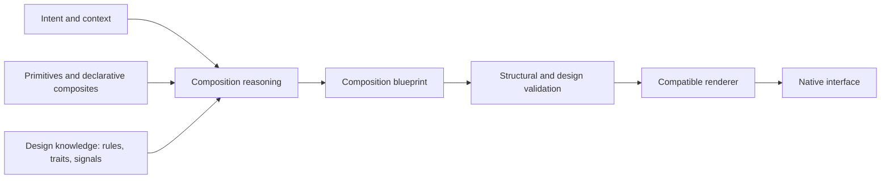
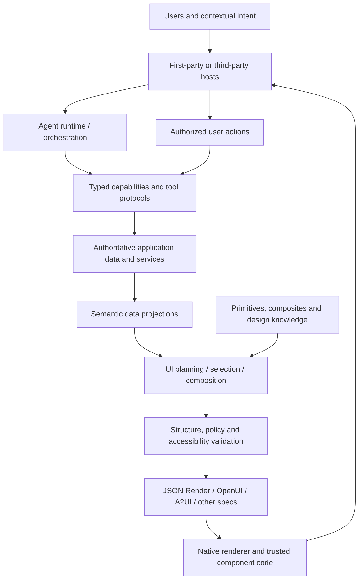
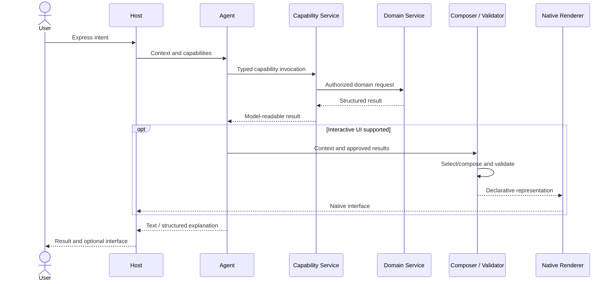

# Generative Interfaces and Agent-First Systems

**Technology landscape, design-system concepts, interoperability, and research findings**  
**Research synthesis · 20 October 2026**

> **Purpose.** This is a technology-neutral research reference, not a target architecture, implementation guide, product strategy, migration plan, or record of architectural decisions. It describes what the technologies do, how their responsibilities overlap or differ, and what remains uncertain. Illustrative structures are conceptual and do not prescribe a stack.

## Executive summary

Generative interfaces are changing how application experiences can be assembled. Instead of selecting only from screens specified in advance, software can use user intent, contextual information, domain data, and machine-readable design knowledge to select or compose interfaces at runtime. This is distinct from generating arbitrary frontend code: most credible production-oriented approaches restrict the vocabulary of components and actions, validate generated structure, and delegate actual rendering and effects to trusted application code.

There is **no single universal generative-UI stack or protocol**. Several technologies are evolving in parallel because they address different layers. [JSON Schema](https://json-schema.org/draft/2020-12) and [OpenAPI](https://spec.openapis.org/oas/v3.2.1.html) describe data and HTTP interfaces. [MCP](https://modelcontextprotocol.io/specification/2026-07-28) exposes tools and data to agent hosts. [MCP Apps](https://modelcontextprotocol.io/extensions/apps/overview) lets tools provide optional interactive interfaces inside compatible hosts. [AG-UI](https://docs.ag-ui.com/introduction) addresses agent–frontend event exchange. [A2UI](https://a2ui.org/) explores interoperable declarative agent-generated UI. [JSON Render](https://www.jsonrender.dev/) and [OpenUI](https://www.openui.com/docs) are different frameworks for producing, interpreting, and rendering constrained generated interfaces. [shadcn/ui](https://ui.shadcn.com/docs) and [Base UI](https://base-ui.com/react/overview/about) address the implementation and ownership of components, not the same protocol problem.

[SAP's Compositional Design System](https://www.sap.com/design-system/compositional-design-system/get-started) provides a particularly clear conceptual model. It separates a relatively small set of **coded atomic and control primitives** from a growing catalog of **declarative composites**, with **design knowledge** capturing usage rules, semantic relationships, accessibility requirements, traits, and signals. A composition service interprets intent and context, selects assets, creates a technology-agnostic blueprint, validates it, and renders it on a compatible surface. That is a methodology and system design, not evidence that SAP uses JSON Render, OpenUI, or a particular third-party agent runtime.

[OpenUI Lang](https://www.openui.com/docs/openui-lang) explores compact, line-oriented UI generation with progressive rendering. Its wider runtime model separates initial model-generated composition from subsequent state changes, queries, calculations, and tool actions. [JSON Render](https://github.com/vercel-labs/json-render) uses schemas, catalogs, specs, and registries to generate controlled component trees, with support for streaming and multiple renderers. [Jev](https://github.com/vercel-labs/json-render/blob/main/packages/core/README.md) is a separate, experimental **decision model** used in JSON Render's candidate-based composition path. Jev is neither a design system nor a UI serialization language; its research significance is the possibility of selecting and arranging approved elements using bounded choices rather than free-form generation. Its present integration and maturity limits remain material.

[Open WebUI](https://docs.openwebui.com/) is best classified as a **complete AI application platform**: a self-hosted chat workspace with model connections, conversations, tools, knowledge features, and native MCP support. It is useful to study as an application/host implementation, but it is not a substitute category for a UI language, component library, or interoperability protocol.

The recurring architectural concept across these approaches is **separation of concerns**: authoritative data, capability definitions, semantic composition, generated representations, runtime state, native rendering, and action authorization are different responsibilities. Their boundaries can be combined or separated in many ways. The research supports treating them as distinct analytical concepts; it does **not** establish one mandatory internal architecture or one winning framework.

---

## 1. Scope, terminology, and evidence

### 1.1 Scope

This report surveys the technical and conceptual landscape for:

- Runtime generation and composition of native interactive interfaces.
- Declarative design systems and machine-readable composition knowledge.
- Controlled UI vocabularies, typed data bindings, actions, and runtime state.
- Agent capabilities, first-party agent interaction, and third-party host embedding.
- Portability, accessibility, safety, evolution, performance, and evaluation.
- Representative frameworks, protocols, and application platforms, including Jev.

It deliberately excludes product-specific features, domain-specific integration examples, repository layouts, implementation phases, architectural decision templates, and technology mandates.

### 1.2 Terms

| Term | Meaning in this report |
| --- | --- |
| **Deterministic UI** | A predefined view selected or populated by application logic without generative composition. |
| **Dynamic UI** | An interface that changes according to data or state; it may be wholly deterministic. |
| **Generative UI** | Interface structure or composition determined at least partly by a generative or decision model at runtime. |
| **Primitive** | A small renderable or interactive building block. |
| **Atomic primitive** | A minimal visual/structural unit ordinarily used inside larger components. |
| **Control primitive** | A smallest meaningful standalone control, such as a button or text input. |
| **Composite** | A reusable arrangement of primitives and possibly other composites, potentially described declaratively. |
| **Catalog** | A controlled inventory of permitted components, composites, actions, and associated metadata. |
| **Design knowledge** | Rules and semantics describing when, why, and how catalog elements may be combined. |
| **Composition blueprint/spec** | A structured description of an interface before or during rendering. |
| **Registry/renderer** | Application or host implementation that maps approved descriptions onto native UI components. |
| **Capability** | A typed operation or resource an agent or application can access under defined permissions. |
| **Host** | The environment displaying an agent interaction, such as a website, AI workspace, or external assistant. |

“**Semantic UI contract**” is a useful conceptual label for catalog semantics, composition rules, data bindings, and action definitions. It is **not a published industry standard**, and neither its name nor one particular structure is necessary to use generative UI.

### 1.3 Interpretation of evidence

The descriptions of published standards and API behavior are drawn primarily from maintainers' specifications and documentation. Product capabilities and maturity can change rapidly; treat version/status statements as a **20 October 2026 snapshot**. Performance results published by framework vendors are attributed to those vendors and are not presented as independent comparisons. Diagrams and layer taxonomies are **analytical syntheses**, not endorsed reference architectures from the cited organizations.

---

## 2. Landscape: distinct technologies at distinct layers

| Technology or approach | Main category | Problem it addresses | Important boundary or limitation |
| --- | --- | --- | --- |
| [JSON Schema 2020-12](https://json-schema.org/draft/2020-12) | Data/schema standard | Machine-readable JSON shape, validation, interoperability | Does not define an agent or interactive UI runtime |
| [OpenAPI 3.2.1](https://spec.openapis.org/oas/v3.2.1.html) | HTTP API specification | Describes operations, parameters, requests, responses | Does not create automatic discovery inside an arbitrary assistant |
| [Arazzo](https://spec.openapis.org/arazzo/latest.html) | Workflow specification | Describes sequences/dependencies across API operations | Workflow description rather than an agent UI protocol |
| [MCP](https://modelcontextprotocol.io/specification/2026-07-28) | Agent capability protocol | Tool, resource, prompt, and host/client/server interoperability | Tool compatibility does not itself imply custom UI support |
| [MCP Apps](https://modelcontextprotocol.io/extensions/apps/overview) | Embedded host UI extension | Optional interactive UI attached to tool responses | Depends on host support and sandboxed UI resources |
| [AG-UI](https://docs.ag-ui.com/introduction) | Agent–frontend event protocol | Streaming events, shared state and interaction lifecycles | Not a component system or MCP replacement |
| [A2UI](https://a2ui.org/specification/v0.9.1-a2ui/) | Declarative agent UI protocol | Cross-client representation of agent-specified UI | Ecosystem and compatibility maturity remain active research areas |
| [JSON Render](https://github.com/vercel-labs/json-render) | Generative UI framework | Catalog-constrained specs and native renderer integration | Framework conventions need not become universal domain contracts |
| [OpenUI / OpenUI Lang](https://www.openui.com/docs/openui-lang) | Generative UI language and runtime | Compact streamed descriptions, reactive state and tool-connected UI | Framework/runtime semantics differ from JSON Render and A2UI |
| [Jev](https://github.com/vercel-labs/json-render/blob/main/packages/core/README.md) | Experimental composition decision model | Selects/arranges approved candidates via discrete decisions | Not a UI protocol, component library, or demonstrated universal replacement for generation |
| [shadcn/ui](https://ui.shadcn.com/docs) | Component distribution/ownership | Application-owned, editable UI component source and registries | Not itself a model-facing composition format |
| [Base UI](https://base-ui.com/react/overview/about) | Accessible React primitives | Unstyled interactive behaviors and component building blocks | React implementation technology, not cross-host UI language |
| [Radix UI](https://www.radix-ui.com/primitives) | Accessible React primitives | Unstyled interactive React component behavior | Distinct implementation API and tradeoffs |
| [React Aria](https://react-spectrum.adobe.com/react-aria/) | Accessible React behavior/components | Accessibility and interaction primitives | Another implementation family, not a generative UI protocol |
| [SAP Compositional Design System](https://www.sap.com/design-system/compositional-design-system/get-started) | Design-system methodology and services | Machine-readable design knowledge plus runtime composition | SAP-specific implementation is not interchangeable with these frameworks |
| [Open WebUI](https://docs.openwebui.com/) | Complete AI application platform | Hosted/self-hosted chat, model access, tools, knowledge and administration | A host/application, not a UI representation standard |
| [Vercel Eve](https://vercel.com) and similar agent runtimes | Agent application/runtime category | Model and agent orchestration, sessions, tools, transport | Agent runtime choice is separate from design-system composition choice |
| [OpenTelemetry GenAI conventions](https://opentelemetry.io/docs/specs/semconv/gen-ai/) | Observability conventions | Tracing model/tool activity, tokens, latency and related operations | Telemetry contract, not a UI framework |

The apparent competition between several named products is often a **category error**. MCP and AG-UI, for example, can coexist because one concerns agent-accessible capabilities and the other agent–frontend interaction. JSON Render and OpenUI are closer alternatives because they both provide model-to-UI representations and runtimes. Base UI and shadcn/ui are complementary at a different layer. Open WebUI could host tools defined elsewhere without becoming their UI contract.

### 2.1 The generation-freedom spectrum

| Interaction mode | Model influence on interface | Typical properties |
| --- | --: | --- |
| Fixed screen | None | Tested arrangement; dynamic values still possible |
| Data-driven components | Very low | Known native component receives different data |
| Composite selection | Low | Model or decision logic selects from known experience patterns |
| Constrained composition | Moderate | Approved primitives/composites arranged under rules |
| Fine-grained composition | High | Many individual components selected and connected dynamically |
| Arbitrary generated code | Extreme | Broad expressiveness, high validation and execution risk |

These modes are not a linear maturity ladder. More generation freedom can increase variety while also increasing output size, repair complexity, accessibility variance, and the surface for unintended actions. A screen can be dynamic and highly personalized without being model-composed on every interaction.

---

## 3. Compositional design systems: SAP's research contribution

The most consequential shift in SAP's published material is from a **component library** toward a **machine-readable design system capable of describing valid compositions**. Conventional design systems already capture visual tokens, components, patterns, and usage guidance for humans. Runtime composition requires that some of this tacit knowledge become explicit enough for a model or orchestration service to inspect and validate. Sources: [SAP Compositional Design System overview](https://www.sap.com/design-system/compositional-design-system/get-started) and [evolving design systems for AI-driven UX](https://www.sap.com/latinamerica/design/stories-resources/evolving-design-systems-for-ai-driven-ux).

### 3.1 Component catalog

SAP describes two principal catalog classes:

**Primitives.** A relatively small set of coded elements implemented by the rendering technology. **Atomic primitives** supply minimal visual/structural units, such as a graph axis or arrow. **Control primitives** are the smallest independently useful controls, such as buttons. They carry the lower-level semantics, accessibility, interaction behavior, and rendering responsibilities.

**Declarative composites.** Composites combine primitives, and sometimes other composites, using declarative composition descriptions rather than requiring a separately coded component for every possible pattern. SAP describes JSON composition descriptions for its composites. This permits the catalog of compositions to grow much larger than the coded primitive set. A composite still depends on the renderer supporting the required layout, behaviors, state, and actions; a JSON description alone is not a complete UI implementation.

The distinction is important: **“composite” does not necessarily mean “another handcrafted React component.”** Depending on the design system, it may be a validated declarative recipe. Coded domain-level components can still exist where encapsulated behavior or complexity warrants them.

### 3.2 Design knowledge

SAP's Design Knowledge layer covers how the building blocks should be used. Its documented concepts include:

| Knowledge category | Research significance |
| --- | --- |
| **Primitive rules** | Conditions, constraints, and correct usage for basic building blocks |
| **Composite rules** | Valid membership, ordering, nesting, layout, and interactions between elements |
| **Universal rules** | System-wide requirements, including consistency and accessibility |
| **Information model** | Shared semantics and relationships that help composition reasoning |
| **Traits** | Attributes of components, information, or situations relevant to selection/composition |
| **Signals** | Contextual cues from intent, task, environment, or state that influence composition |

These are design-system concepts, not a claim that every external framework exposes SAP's exact metadata model. Framework catalogs may encode only portions of this knowledge. Some richer relationships require custom validation or policy layers.

### 3.3 Composition service

SAP describes responsibilities including **intent analysis, planning, asset management, component selection, generation, validation, and rendering**. The result is conceived as a **technology-agnostic blueprint** before being rendered for a target interface. SAP's documentation does not require that these responsibilities execute as a rigid linear pipeline on every interaction.

A neutral conceptual illustration is:



### 3.4 Consequences for the wider ecosystem

This research suggests that **semantics and valid relationships matter as much as syntactic validity**. An output can conform perfectly to a UI language while remaining visually incoherent, inaccessible, or ill-suited to the user's task. It also shows why changing the UI serialization format cannot, on its own, solve composition quality.

SAP explicitly allows deterministic design-time UI and runtime-composed UI to coexist. Its compositional system extends existing web/mobile design-system foundations rather than replacing them. Nothing in SAP's sources establishes that its internal implementation uses JSON Render, OpenUI, A2UI, Jev, or any particular React primitive library.

---

## 4. Representations and runtimes for generated UI

### 4.1 JSON Render

[JSON Render](https://github.com/vercel-labs/json-render) distinguishes three concepts:

1. **Catalog:** a constrained vocabulary of named components and actions, including schemas and descriptions.
2. **Spec:** a structured, typed representation of selected components, props, state references, and relationships.
3. **Registry/renderer:** the actual implementation that maps those names onto native UI components and permitted actions.

The project's documentation covers schema validation, prompt/schema generation, streaming spec updates, state/action bindings, and multiple renderer integrations. Its [`@json-render/mcp`](https://github.com/vercel-labs/json-render) integration connects JSON Render interfaces to MCP Apps by delivering a bundled UI resource to an embedded host. This does **not** require the host itself to natively understand JSON Render: the embedded bundle carries its own renderer.

A significant advantage of catalog-based systems is controlling the model-visible vocabulary. A significant burden is maintaining consistency among catalog definitions, renderer implementations, state bindings, actions, and generated specs. Schema-valid output alone cannot guarantee an appropriate interface.

The project's `@json-render/shadcn` implementation has historically documented Radix-backed prebuilt components. That package's implementation must not be conflated with the separately evolving defaults of shadcn/ui itself. See [JSON Render project](https://github.com/vercel-labs/json-render) and [shadcn changelog](https://ui.shadcn.com/docs/changelog/2026-07-base-ui-default).

### 4.2 OpenUI and OpenUI Lang

[OpenUI Lang](https://www.openui.com/docs/openui-lang) is a compact, line-oriented language designed for model-generated UI and progressive rendering. It expresses named elements and their relationships without the full repetition common to verbose JSON trees. An application provides a controlled component library and relevant tool definitions; a model emits OpenUI Lang; a parser/renderer maps that representation to native components.

The broader [OpenUI runtime architecture](https://www.openui.com/docs/openui-lang/architecture) makes a second distinction: **generation** versus **execution**. The initial model output can establish the interface, state, data dependencies and permitted actions; subsequent ordinary interactions may then execute through application tools and reactive state without another LLM invocation. OpenUI documents reactive `$variables`, data `Query`/`Mutation` constructs, and actions that update state or invoke allowed tools. These are useful to study even when a different serialization format is used.

OpenUI also documents streaming-time reliability/repair mechanisms. These address invalid generated syntax and provider failures, but they should be distinguished from domain authorization, accessibility validation, or semantic composition correctness.

**Naming distinction:** _OpenUI Lang_ is the language discussed here. The word _OpenLang_ by itself can refer to unrelated projects; it is not a sufficient identifier for the generative UI technology.

### 4.3 A2UI

[A2UI](https://a2ui.org/) focuses on a portable declarative representation sent from an agent to compatible clients. Its goal is to describe structured native UI without transmitting arbitrary executable UI code. The value proposition is cross-client interoperability when independent producers and consumers support the protocol. The tradeoff is the need for compatible clients, supported components, and maturity across evolving specifications. As recorded in the source research, v0.9.1 was published/current while v1.0 appeared as a candidate; version status should always be checked at the time of evaluation. See [A2UI v0.9.1](https://a2ui.org/specification/v0.9.1-a2ui/) and [roadmap](https://a2ui.org/roadmap/).

### 4.4 Comparative characteristics

| Dimension | JSON Render | OpenUI / OpenUI Lang | A2UI |
| --- | --- | --- | --- |
| Principal abstraction | Catalog-constrained JSON spec | Compact generative language plus reactive runtime | Interoperable declarative agent UI protocol |
| Allowed components | Schema/catalog | Application-controlled component library | Client-supported catalog |
| Native component rendering | Yes | Yes | Yes, where renderer supports it |
| Model-generated executable UI code | Not required | Not required | Explicitly avoids arbitrary code |
| Generation/streaming | Streamable spec updates | Line-oriented progressive output | Structured progressive delivery |
| Client interaction | Registry, state and actions | Reactive variables, runtime queries/actions | Protocol/client-specific handling |
| Multi-framework ambitions | Multiple web and native renderers | React/Vue/Svelte/Angular tooling described | Multi-client/cross-platform design goal |
| MCP Apps relation | Dedicated ecosystem integration | Can be hosted through an adapted embedded app | May coexist with MCP transport |
| Principal risk | Catalog/renderer coupling and schema evolution | Emerging language/runtime semantics and reliability | Interoperability maturity and client coverage |

The technologies overlap, but no result from this survey demonstrates a universally superior representation across all model families, device classes, component catalogs, and agent hosts.

### 4.5 Published performance comparisons

An [OpenUI-published benchmark](https://www.openui.com/benchmarks) reported the following figures across its evaluation runs:

| Measurement                              | OpenUI | JSON Render |   A2UI |
| ---------------------------------------- | -----: | ----------: | -----: |
| Structural validity                      |  96.9% |       82.8% |  95.6% |
| Successful render                        |  99.9% |       99.6% |  96.6% |
| Combined prompt/output tokens per screen |  6,393 |      10,909 | 15,433 |

The underlying report described 1,104 runs per format. These figures are **vendor-published, not independently replicated**, and experimental setup influences comparisons. They are evidence of a possible efficiency advantage under the tested conditions, not proof that the same ranking holds in other catalogs or real applications. Valid syntax, successful rendering, complete requirements, safe actions, and usable interaction are different outcome measures.

---

## 5. Jev: decision-model composition

Jev merits separate coverage because its mechanism is categorically different from generating a UI language.

### 5.1 What the published integration does

In [JSON Render's experimental decision-model composition](https://github.com/vercel-labs/json-render/blob/main/packages/core/README.md), Jev (`typesafe-ai/jev`) acts as an evaluator for discrete choices. Instead of asking a generative model to write a full component tree, the composer receives **application-supplied candidates** (with identifiers, descriptions and predeclared elements), a controlled catalog, context, state, and composition constraints. The evaluator helps decide which approved elements belong in a tree and how to arrange them. The surrounding composition library validates the resulting structure and expresses it as an ordinary JSON Render `Spec`.

This separates at least three concerns:

- **Candidate supply:** what components/data/actions are admissible at all.
- **Decision/evaluation:** which choices are preferred under a prompt and composition context.
- **Composition and rendering:** how choices form a valid tree and are turned into a native interface.

Jev is not an agent transport, MCP extension, HTML renderer, general-purpose UI coding model, or substitute for server-side business validation. The discrete-choice model can be studied as one possible component of a wider composition system.

### 5.2 Experimental APIs and mechanics

The JSON Render source documents `experimental_composeSpec` and `experimental_createEvaluator`, with Jev connected through Vercel AI Gateway. Candidates can include `id`, `description`, an atomic `element` with `type`/`props` and optional bindings, root eligibility, usage limits, and resource groups. Catalog slot definitions constrain attachment and nesting. Composition events expose intermediate snapshots and completion/stop outcomes; the experimental system also covers editing an existing composition. Recent source documentation describes batched selection/layout decisions and sequential editing strategies. See [core README](https://github.com/vercel-labs/json-render/blob/main/packages/core/README.md), [Jev integration notes](https://github.com/vercel-labs/json-render/blob/main/apps/web/lib/jev/README.md), and [JSON Render changelog](https://github.com/vercel-labs/json-render/blob/main/CHANGELOG.md).

Its documented APIs are explicitly **experimental**, and integration notes caution that transport/model APIs may change. The Jev option is also an example evaluator, not the definition of the generic composition interface.

### 5.3 Distinctive research questions

Jev raises several useful questions that remain unresolved by the public integration alone:

| Question | Why it matters |
| --- | --- |
| How well does discrete selection scale as the candidate catalog grows? | Larger catalogs can increase decision complexity |
| Is selection/layout measurably more reliable than free-form generation? | A bounded choice space may reduce invalid structure |
| How do sequential versus batched decisions affect latency and cost? | More decisions do not automatically mean more efficient execution |
| How complete are composition edit operations? | Revisions require preserving state and existing valid relationships |
| How model-specific are evaluator behaviors? | The abstraction claims to be model-neutral, but provider support varies |
| What exists independently of JSON Render's experimental API? | The public integration does not establish a drop-in framework-independent Jev renderer |
| What happens on incomplete, unavailable, or invalid output? | Partial compositions and deterministic alternatives affect resilience |

The significance of Jev is its **alternative model of composition reasoning**, not a categorical finding that it should replace a generative UI language. JSON Render's reference implementation currently joins Jev evaluation to JSON Render spec creation; that is a concrete integration relationship, not proof that Jev and JSON Render are inseparable in principle.

---

## 6. Component foundations and design-system ownership

[shadcn/ui](https://ui.shadcn.com/docs) is a system for distributing source-owned components and registry entries, rather than only consuming an opaque compiled widget library. [Base UI](https://base-ui.com/react/overview/about), [Radix](https://www.radix-ui.com/primitives), and [React Aria](https://react-spectrum.adobe.com/react-aria/) provide alternative low-level React accessibility/interaction foundations. shadcn's 2026 documentation records Base UI as the default for new setups while retaining support for other bases; it does not imply that an existing working application must migrate. [Sources](https://ui.shadcn.com/docs/changelog/2026-07-base-ui-default) · [React Aria addition](https://ui.shadcn.com/docs/changelog/2026-07-react-aria).

| Concern | Primitive/component system | Generative composition layer |
| --- | --- | --- |
| Keyboard/focus mechanics | Typically implemented here | Must preserve and validate their use |
| Visual tokens and CSS | Implemented here | Referenced/obeyed, not reinvented arbitrarily |
| Semantic role of a screen region | Sometimes partly implemented | Often expressed in catalogs/composites |
| When components may be combined | Usually documented for people | Needs machine-readable constraints for model composition |
| What model may generate | Not necessarily specified | Controlled by vocabulary/catalog |
| Server-side authorization | Outside component library | Must remain outside untrusted model output |

A **semantic component** hides some implementation-specific details and conveys a meaningful purpose. A **declarative composite** describes valid relationships among primitives and other composites. These are distinct ideas: a semantic component can be coded, and a declarative composite can be interpreted by a renderer without new component code. A model-visible catalog containing only raw flex containers and primitive APIs can increase output freedom at the expense of usability and consistency; a catalog containing only highly rigid whole screens can constrain adaptation. The available design space includes combinations.

[AI Elements](https://ui.shadcn.com/docs/ai-elements/base/plan) represents another adjacent category: reusable components and patterns for chat/agent presentation. It can provide conversation, messages, inputs, streaming states, and tool UI, but it is not itself equivalent to a compositional design-system standard.

---

## 7. Agents, capabilities, hosts, and interactive surfaces

### 7.1 Data and capability descriptions

[JSON Schema](https://json-schema.org/draft/2020-12) defines machine-readable shapes and validation for data. [OpenAPI](https://spec.openapis.org/oas/v3.2.1.html) describes HTTP interfaces independently of their implementations. [Arazzo](https://spec.openapis.org/arazzo/latest.html) is an additional specification for describing operation sequences and workflow dependencies. None of these automatically produces a generative UI.

[MCP](https://modelcontextprotocol.io/specification/2026-07-28) defines interoperability between hosts, clients, and servers exposing capabilities. Its 2026-07-28 specification includes explicit protocol evolution and an emphasis on request information rather than dependence on implicit persistent connection state. Tool descriptions and schemas influence the choices an agent can make. MCP can expose capabilities without exposing their internal HTTP architecture; conversely, an HTTP/OpenAPI service may be wrapped for MCP consumption. These are different interfaces and need not mirror one another exactly.

### 7.2 MCP Apps

[MCP Apps](https://modelcontextprotocol.io/extensions/apps/overview) extends tools with **optional embedded interactive UI**. A supporting host can load the tool-associated UI resource in an isolated frame and communicate with it through a defined bridge. [OpenAI's ChatGPT UI documentation](https://developers.openai.com/plugins/build/chatgpt-ui) describes an iframe-based execution model using the MCP Apps bridge, including `postMessage`/JSON-RPC communication and host security constraints.

Two outputs can coexist:

```text
Tool invocation
  ├─ Structured/model-readable result → remains useful in text-only contexts
  └─ Optional UI resource → richer view in a compatible host
```

The second path depends on host capability. An MCP server alone does not guarantee that an arbitrary assistant can discover the server, that the host supports MCP Apps, or that the host will render a specific UI framework. For example, a JSON Render-based interface can be bundled inside an MCP App iframe rather than requiring the outer host to interpret JSON Render syntax.

### 7.3 AG-UI

[AG-UI](https://docs.ag-ui.com/introduction) describes the bidirectional event stream between agent backends and interactive clients. Its concern is agent events, message/progress streaming, shared-state updates, and interaction lifecycles. That is not the same concern as MCP's tool interfaces or a UI representation language's element tree. Rich interactive systems may have both; simpler request/response systems may not need a separate agent-event protocol.

### 7.4 First-party agent runtimes

Agent runtime implementations—including frameworks such as Vercel Eve—may own model selection, tools, conversations, session lifecycle, streaming, and transport. These runtime responsibilities are separate from generated UI serialization and visual primitive implementation. The current evidence does not establish a universal mapping between one runtime framework and any single UI language or protocol; integration needs to be assessed through actual event and tool contracts.

### 7.5 Open WebUI as an application platform

[Open WebUI](https://docs.openwebui.com/) offers a self-hosted AI application interface, compatible with local model setups and hosted model APIs. Its documented features include multi-model chat, conversations, documents/RAG, tool connections, voice, image features, user/access administration and extensibility. It has [native MCP Streamable HTTP support](https://docs.openwebui.com/features/extensibility/mcp/), while other transport configurations may use adapters such as its MCP-to-OpenAPI bridge.

This makes Open WebUI a meaningful reference for **how a complete host/product assembles many of the previously described capabilities**. It does not make Open WebUI a competing replacement for OpenUI Lang, JSON Render, A2UI, Base UI, or SAP's declarative composite methodology. Its host security and administration model also creates constraints—for example, its documented MCP server configuration is administered rather than freely delegated to every user.

### 7.6 Discovery is not the same as technical compatibility

A public service can be reachable on the web without being automatically available as a selected agent tool. At least three mechanisms are distinct:

1. **Web content discovery** through crawling/indexing, which can make public pages available to search and citation systems.
2. **Capability discovery and activation** through host-specific integrations or plugin directories, where metadata, approval, auth and availability matter.
3. **Embedded interactive UI** inside hosts that explicitly support a UI extension such as MCP Apps.

For ChatGPT, [OAI-SearchBot guidance](https://platform.openai.com/docs/bots) describes eligible search visibility for public content, while [OpenAI's plugin documentation](https://developers.openai.com/plugins) describes structured tool integration and publication. A publicly hosted OpenAPI specification is valuable interoperability documentation, but it is not a guarantee of automatic invocation in ChatGPT. Host distribution and discovery can change independently of MCP and UI rendering standards.

---

## 8. Conceptual boundaries and information flow

The architecture below is an **analytical layer diagram**. Actual systems may combine layers, omit some, or use different interfaces between them.



### 8.1 Three distinct information contracts

**Data contracts** describe facts and records. **Capability contracts** describe operations, resources and required permissions. **Presentation contracts** describe what can be shown and which interactions a rendered interface may expose. Conflating them can create fragile coupling: changing a UI renderer should not alter the meaning of authoritative data, and model-selected UI actions should not bypass server authorization.

A generic end-to-end flow is:



This illustrates **headless and interactive outputs as complementary**. It also illustrates why generated presentation is ordinarily treated as derived from authoritative data rather than as its source of truth.

### 8.2 Selection and composition are not equivalent

A model or rules system may select from predefined layouts, configure a known composite, assemble a larger tree, or synthesize an interface description. Jev's candidate-based choices are especially relevant to the first three cases. OpenUI Lang and JSON Render can express descriptions generated by wider model processes. Deterministic rules may also coexist in the same overall experience. The formal relationships between semantic catalog, decision mechanism, and renderer vary with implementation.

---

## 9. State, actions, safety, and accessibility

### 9.1 Generated structure is not executable authority

A declarative interface can reference an action, but an approved action name is not permission to execute it. Trusted handlers must validate inputs, user identity, data access and operation-specific constraints. The generated representation should not acquire direct unrestricted access to arbitrary APIs or executable code.

A useful security analysis considers separate boundaries:

```text
Untrusted user / retrieved content / model output
   ↓
Syntax and schema validation
   ↓
Catalog membership and composition validation
   ↓
Access-control and data-scope validation
   ↓
Action-specific authorization and risk checks
   ↓
Trusted native rendering or execution
```

The ordering can vary, and many authorization checks must also occur independently within services. A prompt instruction is not an authorization boundary.

### 9.2 Authentication and consequences

MCP authorization and application permissions are related but distinct. [MCP security guidance](https://modelcontextprotocol.io/docs/2026-07-28/tutorials/security/security_best_practices) addresses token audience/intent, resource access, and protocol threats. [OpenAI's plugin guidance](https://developers.openai.com/plugins/build/auth) discusses OAuth and consent for authenticated integrations. A read-only capability, a reversible write, and a consequential action can carry different risks, consent requirements, and audit expectations. Embedded UI authorization cannot replace the server-side controls enforced on non-UI tool invocations.

### 9.3 Prompt injection and provenance

Retrieved pages, files, external records, and model-generated content can contain hostile instructions or misleading data. A compositional renderer should treat these as untrusted inputs; an agent's reasoning about them must not implicitly grant action permissions. [OWASP guidance for agentic systems](https://genai.owasp.org/resource/owasp-top-10-for-agentic-applications-for-2026/) and [NIST's Generative AI Profile](https://www.nist.gov/publications/artificial-intelligence-risk-management-framework-generative-artificial-intelligence) provide complementary security and governance perspectives. Neither substitutes for relevant local privacy, sector, or accessibility requirements.

### 9.4 Accessibility as a composition property

A primitive can be accessible in isolation and still participate in an inaccessible composed interface. Composition must account for heading order, naming, keyboard navigation, focus ownership, error messaging, screen-reader announcements, sufficient contrast, reduced-motion behavior, and the relationship between input controls and visible results. This is central to SAP's argument for universal, primitive, and composite rules. Accessibility validation must examine the **whole rendered experience**, not only individual component packages.

### 9.5 Data minimization and isolated hosting

Models and embedded renderers should receive no more sensitive data than is required for their specific role. Correlation IDs, structured usage telemetry, and redacted event metadata often serve diagnostics better than retaining raw user content. MCP Apps' host iframe sandbox and content-security policies provide meaningful isolation, but not an exemption from reviewing tool permissions, output data, third-party scripts, or cross-frame communication.

---

## 10. Reliability, performance, and lifecycle

### 10.1 Separate generation from execution

Repeatedly asking a model to regenerate a screen on every click adds latency, cost and unpredictability. The OpenUI runtime makes this distinction explicit: the model can generate structure and wiring, after which local state, tool-backed queries, and registered actions run without another model call. JSON Render's state bindings similarly allow interactive native components. The underlying pattern is broader than either product: **reasoning and routine interaction are separable processes**. See [OpenUI architecture](https://www.openui.com/docs/openui-lang/architecture) and [reactive state](https://www.openui.com/docs/openui-lang/reactive-state).

### 10.2 Composition granularity and output size

A selection among known composites is ordinarily smaller and easier to validate than a long list of low-level UI primitives. Fine-grained generation may permit more novel arrangements but introduces more opportunities for poor layout, excessive tokens and invalid relationships. This is a tradeoff, not a proof that coarse composites always provide better UX.

### 10.3 Cache and lifecycle boundaries

| Information | Typical change pattern | Relevant concern |
| --- | --- | --- |
| Static UI renderer/widget bundle | Release-driven | Content hashing and deployment compatibility |
| Component catalogs and model-facing descriptions | Release or catalog version | Prompt caching and version identity |
| Tool/capability descriptions | Version/change-driven | Agent discovery and metadata cache invalidation |
| Domain read results | Data-specific freshness | Authorization, query equivalence, expiration |
| Generated UI structure | Context-dependent | Data/policy/model/catalog equivalence |
| User-specific results | Per user or tenancy | Isolation and unauthorized cache reuse |

A generated representation may outlive the catalog version under which it was produced. That creates questions of compatibility, migration, deprecation and rollback. Independently evolving boundaries can include domain schema versions, API/protocol versions, capability versions, catalog versions, composite definitions, UI representation versions and renderer versions. These are analytical dimensions, not a required file layout or naming scheme.

### 10.4 Failure modes

Partial streaming output, invalid syntax, semantically wrong but valid UI, unavailable model/evaluator, stale state, broken tool calls, missing permissions, and host incompatibility are all separate failure categories. A parser repair step might address invalid representation but cannot repair an unauthorized action or incorrect domain fact. Text-only fallback, predetermined views, last-valid snapshots, error states, and human confirmation are different resilience mechanisms with different tradeoffs.

---

## 11. Evaluation, observability, and research quality

### 11.1 Evaluating UI systems requires more than render success

A comprehensive comparison separates model decisions, representation validity, user experience, and domain correctness:

| Evaluation dimension | Examples of observable measures |
| --- | --- |
| Agent/tool behavior | Tool selection precision/recall; argument validity |
| Domain correctness | Fidelity of returned and presented information |
| Representation validity | Syntax/schema acceptance before repair |
| Composition coherence | Compliance with catalog relationships and UX constraints |
| Rendering | Successful render; partial-render behavior; repair frequency |
| Accessibility | Keyboard, screen-reader, labeling and contrast outcomes |
| Action safety | Unauthorized actions, mistaken confirmations, policy violations |
| Interaction quality | Time to first meaningful element; time to interactive; usability |
| Efficiency | Prompt/output tokens; model/tool latency; total cost; cache hits |
| Portability | Differences across models, clients, devices and host environments |

A visually correct interface can fail its original task. A schema-valid output can omit required controls. A fast stream can produce an unusable intermediate display. Those failures require different tests and metrics.

[OpenAI's tool metadata guidance](https://developers.openai.com/plugins/guides/optimize-metadata) discusses evaluating tool activation with direct, indirect and negative prompts. Its [testing guidance](https://developers.openai.com/plugins) also stresses validating schemas, authentication/error paths, consent, model-readable results and optional UI behavior. The relevant methodology extends beyond any one host.

### 11.2 Observability across system boundaries

A request can involve multiple independently failing operations:

```text
Request / conversation correlation
  ├─ Model reasoning and tool selection
  ├─ Capability invocation
  │   └─ Domain service and data access
  ├─ UI composition
  │   ├─ Validation
  │   └─ Repair / fallback
  ├─ Native render
  └─ Human interaction
      └─ Authorized action / tool execution
```

[OpenTelemetry's GenAI semantic conventions](https://opentelemetry.io/docs/specs/semconv/gen-ai/) cover model, token, and tool-operation measurements. The useful research distinction is between **tracing what happened** and **recording private content**: detailed observability can often be achieved with IDs, metrics, outcomes and redacted parameters rather than raw messages or personally identifying records.

### 11.3 Evaluating vendor claims

Claims about token savings, accessibility, render success, framework portability and host support are sensitive to benchmark prompts, catalog complexity, model/provider choice, repair configuration and measured definitions. A vendor's published comparison is useful evidence about its own experimental setup, not neutral proof of superiority. Source dates and the exact protocol/runtime versions matter because these ecosystems are moving quickly.

---

## 12. Open questions and unresolved research areas

The following are **open technical questions**, not a backlog, roadmap, or list of required decisions:

1. **Semantic portability:** How faithfully can a declarative composite and its accessibility/interaction semantics be represented across JSON Render, OpenUI Lang and A2UI?
2. **Catalog scale:** What happens to composition reliability, latency and prompt size as the set of primitives and composites grows?
3. **Design knowledge:** Which of SAP's traits, signals, and primitive/composite/universal rules can be expressed directly in existing frameworks, and which still require external logic?
4. **Jev generalization:** How much of the decision-model composition technique transfers beyond JSON Render's experimental evaluator/composer APIs?
5. **Streaming semantics:** What constitutes a meaningful, stable partial interface under each representation?
6. **Runtime state:** How consistently can data bindings, query invalidation, local actions and cross-component state be transported between hosts?
7. **Host interoperability:** Which hosts support MCP tools only, MCP Apps embedding, or additional UI protocols, and with which security limitations?
8. **App-platform boundaries:** How much extensibility do complete platforms such as Open WebUI offer without coupling domain capabilities to their own application model?
9. **Accessibility at runtime:** What objective tests can assess an entire generated composition before and after it becomes interactive?
10. **Evaluation reproducibility:** Do the vendor-reported efficiency/reliability differences hold across other models, component sets and workloads?
11. **Governance and evolution:** How can catalogs, action semantics, schema versions and renderers change without breaking previously produced interfaces?
12. **Agent autonomy:** Where do useful declarative choices end and consequential operations begin, especially in systems spanning multiple hosts?

These questions preserve the research value of the original architectural discussion without preselecting outcomes or turning the report into implementation advice.

---

## Sources and further reading

Primary documentation, specifications, and project-maintained sources used in the source report or verified during this revision. Where the source is a benchmark or vendor description, that origin is intentionally explicit.

### Standards and protocols

- [JSON Schema 2020-12](https://json-schema.org/draft/2020-12)
- [OpenAPI Specification 3.2.1](https://spec.openapis.org/oas/v3.2.1.html)
- [Arazzo Specification](https://spec.openapis.org/arazzo/latest.html)
- [MCP specification, 2026-07-28](https://modelcontextprotocol.io/specification/2026-07-28)
- [MCP specification changelog](https://modelcontextprotocol.io/specification/2026-07-28/changelog)
- [MCP tools](https://modelcontextprotocol.io/specification/2026-07-28/server/tools)
- [MCP Apps extension](https://modelcontextprotocol.io/extensions/apps/overview)
- [MCP security best practices](https://modelcontextprotocol.io/docs/2026-07-28/tutorials/security/security_best_practices)
- [A2UI specification v0.9.1](https://a2ui.org/specification/v0.9.1-a2ui/)
- [A2UI roadmap](https://a2ui.org/roadmap/)
- [AG-UI protocol overview](https://docs.ag-ui.com/introduction)

### Design and generative UI

- [SAP: Evolving Design Systems for AI-Driven UX](https://www.sap.com/latinamerica/design/stories-resources/evolving-design-systems-for-ai-driven-ux)
- [SAP: Compositional Design System](https://www.sap.com/design-system/compositional-design-system/get-started)
- [JSON Render repository and documentation](https://github.com/vercel-labs/json-render)
- [JSON Render core and Jev experimental composition](https://github.com/vercel-labs/json-render/blob/main/packages/core/README.md)
- [JSON Render Jev integration notes](https://github.com/vercel-labs/json-render/blob/main/apps/web/lib/jev/README.md)
- [JSON Render changelog](https://github.com/vercel-labs/json-render/blob/main/CHANGELOG.md)
- [OpenUI documentation](https://www.openui.com/docs)
- [OpenUI Lang introduction](https://www.openui.com/docs/openui-lang)
- [OpenUI architecture](https://www.openui.com/docs/openui-lang/architecture)
- [OpenUI Lang reactive state](https://www.openui.com/docs/openui-lang/reactive-state)
- [OpenUI benchmark — vendor-published](https://www.openui.com/benchmarks)
- [shadcn/ui documentation](https://ui.shadcn.com/docs)
- [shadcn: Base UI default announcement](https://ui.shadcn.com/docs/changelog/2026-07-base-ui-default)
- [shadcn: React Aria support](https://ui.shadcn.com/docs/changelog/2026-07-react-aria)
- [Base UI documentation](https://base-ui.com/react/overview/about)
- [Radix primitives](https://www.radix-ui.com/primitives)
- [React Aria](https://react-spectrum.adobe.com/react-aria/)
- [AI Elements](https://ui.shadcn.com/docs/ai-elements/base/plan)

### Host platforms, security, and evaluation

- [OpenAI Plugins documentation](https://developers.openai.com/plugins)
- [OpenAI: MCP server integration](https://developers.openai.com/plugins/build/mcp-server)
- [OpenAI: ChatGPT UI / MCP Apps](https://developers.openai.com/plugins/build/chatgpt-ui)
- [OpenAI: Tool metadata optimization](https://developers.openai.com/plugins/guides/optimize-metadata)
- [OpenAI: Authentication](https://developers.openai.com/plugins/build/auth)
- [Open WebUI documentation](https://docs.openwebui.com/)
- [Open WebUI features](https://docs.openwebui.com/features/)
- [Open WebUI native MCP support](https://docs.openwebui.com/features/extensibility/mcp/)
- [OpenTelemetry GenAI conventions](https://opentelemetry.io/docs/specs/semconv/gen-ai/)
- [OWASP Top 10 for Agentic Applications 2026](https://genai.owasp.org/resource/owasp-top-10-for-agentic-applications-for-2026/)
- [NIST AI RMF Generative AI Profile](https://www.nist.gov/publications/artificial-intelligence-risk-management-framework-generative-artificial-intelligence)

---

**Research status:** This synthesis is a point-in-time, technology-agnostic survey. It deliberately retains multiple competing approaches, their respective limitations, and open questions. It makes **no product-specific commitments and contains no ADRs, implementation phases, or prescribed technology stack**.
