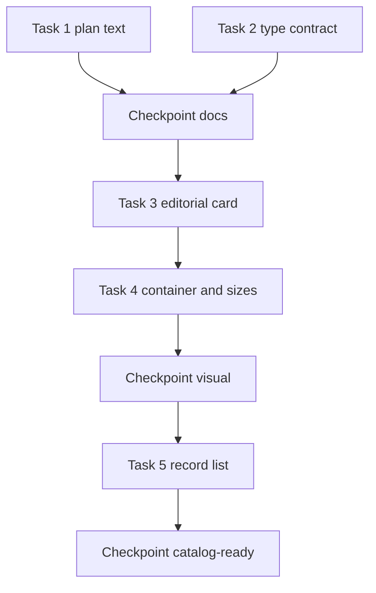

# Catalog readiness — implementation plan

**Status:** Implemented (2026-10-22). Does not authorize OpenUI, a renderer, or homepage GenUI.  
**Deviation:** an editorial card with no registry cover still shows the package image in the same frame. `/work` featured relies on that for Opyn and EOS Costa Rica. The card does not fall back to the bordered anatomy.  
**Corrects:** the OpenUI input sentence and the P3 image-fit acceptance in [SITE-WIDE-IMPLEMENTATION-PLAN.md](./SITE-WIDE-IMPLEMENTATION-PLAN.md).  
**Leaves in place:** [tasks/plan.md](../../../tasks/plan.md) (`public-capabilities`). Do not overwrite that file or create `tasks/todo.md` for this work.

## Objective

Static routes and a future experience catalog share one editorial project anatomy, one named container, and a types-only experience contract. `evidenceUsesEditorial` stays a static-route helper. The archive card stays the archive card. No OpenUI package, renderer, Eve import, or `/ask` change ships in this plan.

## What is already true in the tree

- Homepage selected work uses `ProjectCard` with `variant="editorial"` inside `editorialGrid` (`lg:grid-cols-2`) in [app/page.tsx](../../../app/page.tsx).
- `/work` featured gallery in [components/work/work-project-gallery.tsx](../../../components/work/work-project-gallery.tsx) reuses that same grid, plus `layout="wide"`, plus a separate [components/work/featured-project-card.tsx](../../../components/work/featured-project-card.tsx). The site-wide plan’s “`/work` stays bordered masonry” line is stale for the featured layout. Filtered `/work/[type]` still uses `ProjectsMasonry`.
- [components/work/project-evidence.tsx](../../../components/work/project-evidence.tsx) still resolves slugs with `getProjectBySlug` and renders the bordered card. It has no `presentation` prop yet.
- `/web3` already passes `objectClassName="object-contain"` on `PageImage`. The source is still `public/images/work/ztx.png`. `PageImage`’s default class is `object-cover`.
- The eight experience names live in [SPEC-openui-experiences.md](../homepage-genui/SPEC-openui-experiences.md). Nothing in `lib/genui/` or `components/genui/` implements them.

## Decisions

| Topic | Decision |
| --- | --- |
| Catalog card | One editorial anatomy: cover or an empty media slot, name, role, description, link to `/project/[slug]`. A missing cover does not switch the card to the bordered variant. |
| Archive card | `ProjectCard` default branch. Capability lists and masonry keep it. The experience contract cannot select it. |
| Flagship | `FeaturedProjectCard` stays a `/work` composition. It stays outside the editorial container. This plan does not merge it into the catalog card. |
| Wide frame | The gallery may pass a frame (`video` or `wide`) into the editorial card. That prop is application-owned. The experience contract has no frame, layout, or presentation field. |
| Container | One named container, `@container/editorial`, on the list wrapper. Two columns at container width `48rem` (`@min-[48rem]/editorial`). No per-card container. `ProjectEvidence` does not use this wrapper. |
| Sizes | The parent passes `sizes`. Homepage and `/work` pairs pass a rewritten `editorialCoverSizes` in the same change as the container. `flagshipSizes` stays on the flagship only. A `fill` image always receives `sizes`. |
| Records | `ProjectEvidence` keeps `getProjectBySlug` and remains a Server Component. A presentational list receives already resolved `Project` records and does not import `gaboesquivel`. |
| Static fallback | `evidenceUsesEditorial` remains the site-wide plan’s helper for mixed capability lists. Future OpenUI code does not import it. |
| Experiences | A types-only module names `Answer`, `AboutExperience`, `ProjectExperience`, `WritingExperience`, `ContactExperience`, `BookingExperience`, `CVExperience`, and `ExperienceStack`. It imports no components, covers, images, package lookups, or `@openuidev`. |
| Fit | P3 keeps `object-contain` when `/web3` swaps the ZTX PNG for the registry WebP. |

Adopting the container moves the homepage and `/work` pair grids from viewport `lg` (1024px) to a 48rem content width. Inside `homeColumn` that is roughly an 816px viewport. That earlier two-column break is intentional so the server page and a later embedded experience share one rule.

## Performance constraints

From the [performance re-review](b5d3604c-fac4-46b5-abce-34c96a2bfb6c):

- `app/page.tsx`, `ProjectCard`, the extracted editorial card, `ProjectEvidence`, the presentational list, and `WorkProjectGallery` stay Server Components. A client list would put story and achievements on the flight payload.
- Homepage editorial images stay lazy. The portrait remains the homepage LCP image.
- The container and the `editorialCoverSizes` rewrite ship together. A 48rem grid with today’s viewport size string fetches about twice the slot width between the new break and 1023px.
- Do not set `container-type` on each card. `Card` and field groups already publish containers; an unnamed query would measure those.
- The types module has no value imports.
- Out of this plan: blog-body index, dynamic `ChatSidebar`, portrait `fetchPriority`, OpenUI renderer `import()`.

## Out of scope

- `@openuidev/react-lang`, `components/genui/` renderer, Eve, JSON Render removal, `/ask`, MCP.
- Implementing contact, booking, CV, writing, or about experiences.
- Homepage hero, portrait, search, nav.
- New covers, ZTX character art, Open Graph URLs, `metadata.images`.
- Folding `FeaturedProjectCard` into the catalog.
- Overwriting [tasks/plan.md](../../../tasks/plan.md).

## Tasks

### Task 1: Correct the site-wide plan

**Description:** The approved site-wide plan tells a future OpenUI spec to import `evidenceUsesEditorial`, and its P3 step can drop the existing `object-contain` when the ZTX source changes. This task fixes those two instructions and records that `/work` featured already uses the editorial gallery.

**Acceptance criteria:**

- [ ] The OpenUI input section names the editorial card and `projectCover` as future imports, and states that `evidenceUsesEditorial` stays on static routes.
- [ ] P3 acceptance requires `objectClassName="object-contain"` on the `/web3` `PageImage` after the WebP swap, with the image still lazy.
- [ ] The `/work` route row distinguishes featured gallery from masonry filters.

**Verification:**

- [ ] Path check against the files named above.
- [ ] Diff is markdown only.

**Dependencies:** None.

**Files:** [SITE-WIDE-IMPLEMENTATION-PLAN.md](./SITE-WIDE-IMPLEMENTATION-PLAN.md).

**Scope:** Small.

### Task 2: Types-only experience contract

**Description:** Add the eight experience names and the props a document is forbidden to carry, as types and a small validator. No UI.

**Acceptance criteria:**

- [ ] The module exports the eight names and a check that rejects `presentation`, `variant`, `layout`, `frame`, HTML, CSS, component names outside the eight, endpoint URLs, and tool names.
- [ ] The module’s import graph contains no React components, `projectCover`, `getProjectBySlug`, image assets, or `@openuidev`.
- [ ] A unit test covers one valid id reference and one rejection for each forbidden field.

**Verification:**

- [ ] `bun test` on the new test file.
- [ ] `bun run verify`.

**Dependencies:** None. Parallel with Task 1.

**Files:** `lib/genui/experience-contract.ts`, `lib/genui/experience-contract.test.ts`.

**Scope:** Small.

### Checkpoint: after Tasks 1–2

- [ ] No route markup changed.
- [ ] `tasks/plan.md` untouched.
- [ ] Tests for the contract pass.

### Task 3: Extract the editorial card

**Description:** Move the editorial branch of `ProjectCard` into its own Server Component. Homepage and the work gallery render that component. The bordered branch remains `ProjectCard` and loses `variant` and `layout`.

**Acceptance criteria:**

- [ ] `EditorialProjectCard` takes a `Project`, a required `sizes` string, `showRole`, `priority`, and an optional frame (`video` default, `wide` for the gallery’s middle slot).
- [ ] Cover comes from `projectCover`. When the lookup is missing, the link still renders title, role, and description with no image.
- [ ] Homepage cards pass `editorialCoverSizes`, `priority` false.
- [ ] `FeaturedProjectCard` is unchanged and still uses `flagshipSizes`.
- [ ] Hover scale stays the shipped `scale-[1.02]` with `motion-reduce:transition-none`. DESIGN.md records that editorial and flagship images use it.

**Verification:**

- [ ] `bun run verify`.
- [ ] Browser on `/` and `/work` at desktop and mobile: same covers, roles, and descriptions as before this task. [verify.md](../../agents/verify.md).

**Dependencies:** Checkpoint after Tasks 1–2.

**Files:** `components/work/editorial-project-card.tsx`, `components/work/project-card.tsx`, `components/work/work-project-gallery.tsx`, `app/page.tsx`, `DESIGN.md`.

**Scope:** Medium.

### Task 4: Named container and matching sizes

**Description:** Change `editorialGrid` to a named 48rem container query, and rewrite `editorialCoverSizes` so the two-column band requests the half-column slot. Homepage and `/work` pairs are the only consumers.

**Acceptance criteria:**

- [ ] The wrapper is `@container/editorial`. Columns switch with `@min-[48rem]/editorial`, not `lg:`.
- [ ] `editorialCoverSizes` describes one column below that container width and a half column above it, and still selects the existing 512 image width for the ~532px slot.
- [ ] `ProjectEvidence` keeps `md:grid-cols-2` and its current size strings.
- [ ] The flagship card is outside the container and keeps `flagshipSizes` and its preload.
- [ ] Homepage editorial images stay lazy.

**Verification:**

- [ ] `bun run verify` and `bun run build`.
- [ ] Browser `/` and `/work` at 768, 900, 1024, and 1440. Pairs are one column at 768 and two columns at 900 and above. Flagship stays full width. No horizontal overflow.

**Dependencies:** Task 3.

**Files:** `components/shared/spacing.ts`, `lib/work/project-cover.ts`, `app/page.tsx`, `components/work/work-project-gallery.tsx`, `DESIGN.md`.

**Scope:** Medium.

### Checkpoint: after Tasks 3–4

- [ ] `/`, `/work`, and one filtered `/work/[type]` masonry page.
- [ ] Portrait is still the preloaded homepage image.
- [ ] Production build shows no new client entry for the editorial card.

### Task 5: Presentational editorial list

**Description:** Add a Server Component that renders a homogeneous editorial list from records the caller already resolved. Homepage selected work uses it. `ProjectEvidence` does not.

**Acceptance criteria:**

- [ ] The list accepts `Project[]`, renders `EditorialProjectCard`, and uses `editorialGrid`.
- [ ] It does not call `getProjectBySlug` and does not import the `gaboesquivel` value module.
- [ ] It has no `presentation`, `variant`, or `layout` prop.
- [ ] A slug with no registry cover still renders the editorial text and no image.
- [ ] `ProjectEvidence` still renders bordered `ProjectCard`s. `/bio` is unchanged.

**Verification:**

- [ ] `bun run verify` and `bun run build`.
- [ ] Browser `/` matches the Task 4 grid. Browser `/bio` still shows bordered evidence cards.

**Dependencies:** Task 4.

**Files:** `components/work/editorial-project-list.tsx`, `app/page.tsx`, `DESIGN.md`.

**Scope:** Medium.

### Checkpoint: ready for a later OpenUI module

- [ ] Experience contract test passes.
- [ ] Homepage and `/work` pairs share `EditorialProjectCard` and `@container/editorial`.
- [ ] `evidenceUsesEditorial` is documented as static-route only, whether or not site-wide P3 has implemented it.
- [ ] No `@openuidev`, `eve`, or `@json-render` import was added under `app/page.tsx`, `components/work/`, or `lib/genui/`.

## Dependency graph

Tasks 1 and 2 can run in parallel. Tasks 3–5 are sequential. Site-wide P1–P4 can continue beside Tasks 1–2. P3’s WebP swap should wait until Task 1 has updated its acceptance line. Tasks 3–4 touch `app/page.tsx` and the gallery, so they should not land in the same commit as an unrelated `/work` visual change.

## Risks

| Risk | Mitigation |
| --- | --- |
| Container two-column starts before today’s `lg` | Task 4 browser matrix at 768, 900, 1024, 1440 |
| Size string lags the container and over-fetches | Sizes and container land in one task |
| Editorial card becomes a client island | Server Component constraint; build check at the visual checkpoint |
| Gallery wide slot grows another variant | Frame is a parent argument with two values; the type contract rejects it |
| P3 implementer drops `object-contain` | Task 1 writes that into the site-wide acceptance line |
| This plan is mistaken for the OpenUI module | Status line and out-of-scope list; `tasks/plan.md` stays the capabilities plan |

## Open questions

- The 48rem threshold is still marked for review in the OpenUI spec. This plan uses it for the editorial grid so the server pages do not teach viewport `lg` to a later experience. Confirm that threshold before Task 4 if the homepage break should stay at 1024px until the spec is approved.
- `FeaturedProjectCard` repeats cover lookup, `object-contain`, and `editorialLink`. Sharing its image frame with `EditorialProjectCard` can wait for a separate visual pass.
