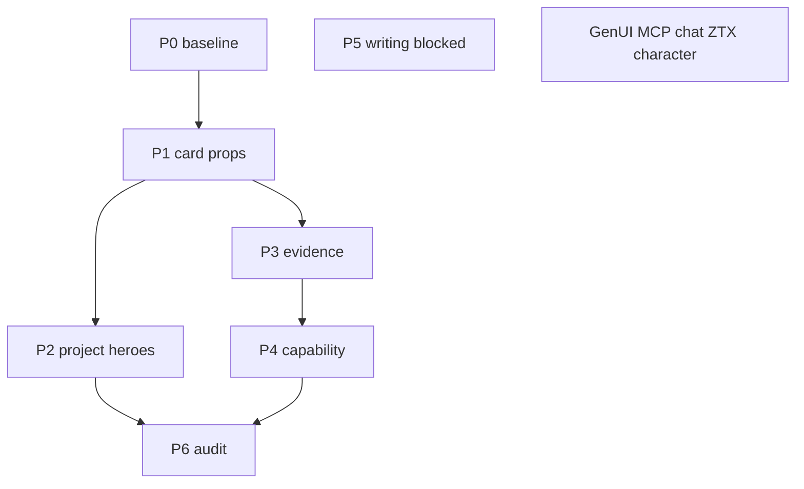

# Site-wide Design System v2 — implementation plan

**Status:** Approved implementation plan (2026-10-22). Alignment pass 2026-10-22 reconciled this file with shipped code and [DESIGN.md](../../../DESIGN.md).  
**Baseline:** [IMPLEMENTATION.md](./IMPLEMENTATION.md) (homepage DS v2 complete).  
**Planning source:** [SITE-WIDE-PLAN-HANDOFF.md](./SITE-WIDE-PLAN-HANDOFF.md).

**Canonical visual rules:** [DESIGN.md](../../../DESIGN.md) wins when this document disagrees (for example `/work` featured gallery, `homeColumn` on work/project routes, `ProjectHero`, `presentation="editorial"`). This file keeps phase history, verification gates, and contracts agents must not break.

This document is the executable plan for extending Design System v2 beyond `/`. It does not authorize homepage GenUI work; see [docs/specs/homepage-genui/CAPABILITIES-homepage-genui.md](../homepage-genui/CAPABILITIES-homepage-genui.md). Active module planning for GenUI stays in [tasks/plan.md](../../../tasks/plan.md) (`public-capabilities`); do not overwrite that file for this rollout.

## Objective

Visitors on work, project, and capability routes see registry covers where a full evidence group is backed by the four approved WebPs. `/work` and `/project/*` use `homeColumn`; capability routes and `/bio` stay on `siteColumn`. Page jobs ([PRODUCT.md](../../../PRODUCT.md)), `/ask`, SEO Open Graph images, and the homepage hero stay unchanged.

## Canonical references

| Doc | Use |
| --- | --- |
| [DESIGN.md](../../../DESIGN.md) | Visual system, components, motion budget |
| [PRODUCT.md](../../../PRODUCT.md) | Per-route jobs, nav, keyword owners |
| [ARCHITECTURE.md](../../../ARCHITECTURE.md) | DS v2 presentation, data boundaries |
| [docs/agents/checks.md](../../agents/checks.md) | Which commands to run per change type |
| [docs/agents/verify.md](../../agents/verify.md) | Browser verification (agent-browser) |
| [docs/agents/propagation.md](../../agents/propagation.md) | Identity/route propagation lists |
| `__dev/gaboesquivel-design-system-v2/docs/QUALITY-GATES.md` | DS-01–DS-14; reuse for routes adopting v2 cover patterns |

Quality gates DS-01–DS-14 apply where a phase touches homepage-adjacent cover or hero patterns. LCP targets in the quality-gates doc are measurement targets, not launch guarantees.

## Locked decisions (do not re-litigate)

| Topic | Decision |
| --- | --- |
| Homepage hero | All-white H1 `Software for humans and agents.`; signature `GABO ESQUIVEL` / `Agentic Software Engineer`; portrait and linework per [IMPLEMENTATION.md](./IMPLEMENTATION.md). [app/page.tsx](../../../app/page.tsx) is not edited in this rollout. |
| Width | [components/layout/site-width.tsx](../../../components/layout/site-width.tsx) applies `homeColumn` (`max-w-6xl`) on every route. Narrative copy uses `readingMeasure` (`max-w-[65ch]`). The résumé stays `max-w-4xl` on screen. CV print unchanged. Homepage files stay untouched. |
| Effects / type | No glow, bloom, glass, decorative gradients; system monospace; accent `#5cded6`. |
| Covers | Presentation-only [lib/work/project-cover.ts](../../../lib/work/project-cover.ts); four WebPs from [assets/work/covers/manifest.json](../../../assets/work/covers/manifest.json). ZTX remains Genesis Home Mint fallback until verified character source art exists. |
| `/ask` work rows | [components/work/project-media.tsx](../../../components/work/project-media.tsx) via [app/connect/eve-thread.tsx](../../../app/connect/eve-thread.tsx); package `project.image` only — not `projectCover`. |
| Reading tokens | No `heroTitle`, `heroPitch`, `homeSection`, or `homeColumn` on non-home routes. |

## Uniform anatomy rule

One list uses one card anatomy. Mixing editorial and bordered cards in a single `ul` is forbidden.

- **Homepage:** editorial 2×2 only on `/` ([homepageEditorialSlugs](../../../lib/work/project-cover.ts)).
- **`/work` featured:** six slugs in [lib/work-types.ts](../../../lib/work-types.ts) via [WorkProjectGallery](../../../components/work/work-project-gallery.tsx) (flagship + editorial pairs/wide row). Registry covers where defined; other slugs use package imagery with `object-contain`. Filtered `/work/[type]` pages use bordered **card** masonry (`ProjectsMasonry` default `variant="card"`).
- **`ProjectEvidence`:** default `presentation` is `"card"`. `presentation="registry"` → editorial only when every slug has a cover (`evidenceUsesEditorial`). `presentation="editorial"` → editorial layout with package image fallback (use on `/bio` chapters, not on mixed capability lists). Capability pages pass **`registry`**, not blind **`editorial`**.

### `evidenceUsesEditorial` contract

Add to [lib/work/project-cover.ts](../../../lib/work/project-cover.ts) and pin with `lib/work/project-cover.test.ts`:

```ts
export const evidenceUsesEditorial = ({
  presentation = "card",
  slugs,
}: {
  presentation?: "card" | "registry";
  slugs: readonly string[];
}) =>
  presentation === "registry" &&
  slugs.length > 0 &&
  slugs.every((slug) => Boolean(projectCover(slug)));
```

Callers pass `presentation="registry"` only; the helper decides fallback to cards for mixed lists.

### Evidence sections: editorial vs card (after P4)

| Route | Editorial (`presentation="registry"` + all slugs covered) | Stays card |
| --- | --- | --- |
| `/ai` | `legal-agent` only | `masterbots` + `bitlauncher` |
| `/fullstack` | `legal-agent`; `bitlauncher` | `wink` + `bitcashbank` |
| `/mobile` | `legal-agent`; `wink` | `make-sense-labs` + `tractor-supply` |
| `/lead` | `wink`; `bitlauncher` | mixed sections (AMC, EOS, etc.) |
| `/startups` | `wink`; `bitlauncher` | `ztx` + `raremint`; `masterbots` |
| `/backend` | `legal-agent` | `chaingraph` + `bitlauncher`; `bitcashbank` + `opyn` |
| `/frontend` | — | all sections |
| `/institutions` | — | all sections |
| `/web3` | — | both `ProjectEvidence` lists; ZTX hero is `PageImage` (see P3) |
| `/bio` | — (capability table) | chapter evidence uses `presentation="editorial"` per [DESIGN.md](../../../DESIGN.md) Career story |

### SEO images vs in-page media

[lib/page-metadata.ts](../../../lib/page-metadata.ts) copies route `metadata.images` into Open Graph and Twitter. These URLs are **out of scope** for cover WebP swaps:

| Route   | Keep `metadata.images`        |
| ------- | ----------------------------- |
| `/ai`   | `/images/work/legalagent.png` |
| `/web3` | `/images/work/ztx.png`        |

In-page ZTX on `/web3` may use `/images/work/covers/ztx.webp` and registry alt; OG array unchanged. Do not edit [scripts/generate-og.ts](../../../scripts/generate-og.ts) or `public/images/og/projects/` in this rollout.

## Image sizes and priority

- Export `projectCardSizes` and `wideProjectCardSizes` from [components/work/project-card.tsx](../../../components/work/project-card.tsx). Do not duplicate size strings in [components/shared/spacing.ts](../../../components/shared/spacing.ts).
- Homepage editorial keeps `editorialCoverSizes` in `project-cover.ts` (6xl two-column grid; [next.config.js](../../../next.config.js) `imageSizes` includes 512).
- Reading-column editorial: `wideProjectCardSizes` for one-up evidence; `projectCardSizes` for two-up.
- Editorial `Image` must honor existing `priority` prop; this rollout does not pass `priority` on new surfaces. Homepage LCP remains portrait preload on `/`.

## Boundaries

| Tier | Rule |
| --- | --- |
| **Always** | Reuse `ProjectCard`, `projectCover`, `page-layout`; package descriptions; run checks per phase; update DESIGN.md / ARCHITECTURE.md when visual or cover ownership changes. |
| **Ask first** | 6xl shell on non-home routes; split featured list on `/work`; writing ToC; new cover files; ZTX character art; agent title alignment; any `agent/` or `app/connect/` edit. |
| **Never** | Homepage hero edits; OpenUI/Eve/MCP Apps/json-render on marketing routes; invented assets; overwrite `tasks/plan.md`; CV print changes; `/ask` `ProjectMedia` → `projectCover`; change route `metadata.images` or project OG outputs. |

## Route groups

### In scope (visual extension)

| Group | Routes | Notes |
| --- | --- | --- |
| Work | `/work`, `/work/[type]` | Featured gallery on `/work`; filtered types use card masonry |
| Project | `/project/[slug]` | [ProjectHero](../../../components/work/project-hero.tsx) uses registry WebP when defined |
| Capability | `/ai`, `/web3`, `/fullstack`, `/frontend`, `/backend`, `/mobile`, `/startups`, `/institutions`, `/lead` | Opt-in evidence per table above |
| Shell audit | `/explore`, `/contact`, `/about`, `/privacy`, `/docs`, `not-found`, `error`, `global-error` | No change unless shared primitive breaks |

### Out of scope or minimal touch

| Group | Routes | Notes |
| --- | --- | --- |
| Homepage | `/` | Reference; no edits |
| Career narrative | `/bio` | Narrative editorial evidence per chapter; not `CapabilityPage` |
| Blog | `/blog`, `/blog/[slug]`, categories | Prose width unchanged; P5 blocked |
| CV | `/cv` | Print surface separate |
| Chat | `/ask` | No DS restyle fighting connect GenUI |
| Tech | `/tech`, `/tech/[category]` | Package masonry |
| MCP | `/mcp`, `/mcp/cv`, `/docs` (integration) | Not marketing DS |
| GenUI | — | Separate initiative |

## Phases

Each implementation phase should be one commit when requested, leave `bun run build` clean, and touch roughly five files or fewer.

### P0 — Baseline (no application code)

**Goal:** Screenshot matrix before code changes.

**Routes:** `/`, `/bio`, `/work`, `/project/legal-agent`, `/project/opyn`, `/ai`, `/web3`, `/fullstack`, `/frontend`, one blog post, `/cv` (screen + print), `/explore`, `/ask`.

**Viewports:** 320, 375, 430, 768, 1024, 1280, 1440, 1920 (per quality-gates doc). Screenshots stay uncommitted (`__dev` or local only).

| Acceptance                                   | Verification |
| -------------------------------------------- | ------------ |
| Notes or screenshots exist for listed routes | Manual       |
| No source diff                               | `git status` |
| `/bio` captured as canary                    | Manual       |

**Rollback:** N/A.

---

### P1 — Editorial image props

**Goal:** Editorial branch supports `sizes` and `priority` without changing visible routes except `/` still using defaults.

| File | Change |
| --- | --- |
| [components/work/project-card.tsx](../../../components/work/project-card.tsx) | Export `projectCardSizes`, `wideProjectCardSizes`; editorial optional `sizes` (default `editorialCoverSizes`); pass `priority` / `fetchPriority` like card branch |
| [DESIGN.md](../../../DESIGN.md) | Uniform-anatomy rule; homepage keeps `editorialCoverSizes` |

| Acceptance | Verification |
| --- | --- |
| `/` editorial cards unchanged (sizes, no priority) | [verify.md](../../agents/verify.md) on `/` desktop + mobile; DS-08, DS-09 |
| `/blog`, `/cv` markup unchanged | Diff scope |
| Velite + lint clean | `bun run verify` |

**Depends on:** P0 (recommended).  
**Rollback:** Revert the two files.

---

### P2 — Project heroes (four covers)

**Goal:** Primary project hero uses registry WebP when `projectCover(slug)` exists.

| File | Change |
| --- | --- |
| [components/work/project-hero.tsx](../../../components/work/project-hero.tsx) (and [project.tsx](../../../components/work/project.tsx)) | Cover WebP + registry alt + `object-contain`; else package image |
| [ARCHITECTURE.md](../../../ARCHITECTURE.md) | DS v2 subsection: covers beyond homepage |

| Acceptance | Verification |
| --- | --- |
| `/project/legal-agent`, `wink`, `ztx`, `bitlauncher` show registry WebP; ZTX still Genesis Home Mint | Browser |
| `/project/opyn` unchanged package hero | Browser |
| `/work` featured gallery; `/work/[type]` card masonry | Browser |
| `homeColumn` on work/project | Visual |
| No OG project PNG diff | `bun run build`; `git diff public/images/og/projects/` empty |
| Homepage DS-01–DS-12 | Browser + quality-gates checklist |
| Content exports | `bun run verify`, `bun run test:llms`, `bun run verify:routes` |

**Depends on:** P1 (shared Image behavior).  
**Rollback:** `project.tsx` hero selection only.

---

### Checkpoint — after P1–P2

- [ ] Homepage and `/bio` match P0
- [ ] Project OG diff empty
- [ ] `/work` masonry still bordered cards

---

### P3 — Opt-in evidence + `/web3` PageImage

**Goal:** `evidenceUsesEditorial` + `ProjectEvidence.presentation`; `/ai` LegalAgent editorial; `/web3` in-page ZTX WebP only.

| File | Change |
| --- | --- |
| [lib/work/project-cover.ts](../../../lib/work/project-cover.ts) | `evidenceUsesEditorial` |
| `lib/work/project-cover.test.ts` | default card; registry one slug; registry mixed pair; empty list; bio slug sets without prop |
| [components/work/project-evidence.tsx](../../../components/work/project-evidence.tsx) | `presentation` default `"card"`; editorial sizes from exported card constants |
| [app/ai/page.tsx](../../../app/ai/page.tsx) | `presentation="registry"` on `slugs={["legal-agent"]}` only; `metadata.images` unchanged |
| [app/web3/page.tsx](../../../app/web3/page.tsx) | `PageImage` → cover WebP + registry alt; `metadata.images` still `ztx.png` |

| Acceptance | Verification |
| --- | --- |
| LegalAgent evidence editorial on `/ai` | Browser desktop + mobile |
| Assistants row + both `/web3` evidence rows stay cards | Browser |
| `metadata.images` URLs unchanged on `/ai`, `/web3` | Read source / diff |
| `/web3` `PageImage` keeps `objectClassName="object-contain"` and stays lazy (no `priority`) after the WebP swap | Read `app/web3/page.tsx` |
| llms corpus unchanged for touched pages | `bun run test:llms` |
| Unit tests pass | `bun test lib/work/project-cover.test.ts` |
| Build clean | `bun run verify`, `bun run build` |

**Depends on:** P1. Independent of P2 order after P1.  
**Rollback:** Five files; keep cover binaries.

---

### P4 — CapabilityPage opt-in

**Goal:** [components/work/capability-page.tsx](../../../components/work/capability-page.tsx) passes `presentation="registry"` to `ProjectEvidence`; mixed sections stay cards via helper.

| File | Change |
| --- | --- |
| [components/work/capability-page.tsx](../../../components/work/capability-page.tsx) | `presentation="registry"` on `ProjectEvidence` |
| [DESIGN.md](../../../DESIGN.md) | Capability evidence opt-in sentence if needed |

| Acceptance | Verification |
| --- | --- |
| Editorial sections per table above | Browser `/fullstack`, `/lead` |
| `/frontend`, `/institutions`, mixed sections = cards | Browser |
| `/bio` chapter evidence still `presentation="editorial"` | Browser `/bio` |
| `/explore`, `/tech`, `/ask`, `/cv` print, `/mcp` match P0 | Spot check |
| Exports | `bun run verify`, `bun run test:llms` |

**Depends on:** P3.  
**Rollback:** `CapabilityPage` + DESIGN sentence.

---

### P5 — Writing shell (blocked)

Wide outer canvas and sticky ToC require explicit product approval and a PDR under `docs/pdr/` before code. Prose in [components/mdx.tsx](../../../components/mdx.tsx) and [app/blog/[slug]/page.tsx](../../../app/blog/[slug]/page.tsx) title measure stay. See [docs/agents/content.md](../../agents/content.md).

**Not a gate for P1–P4 or P6.**

---

### P6 — Discoverability audit

**Goal:** Confirm visual phases did not drift identity, OG, or exports.

| Check | Command / action |
| --- | --- |
| Public role strings unchanged | Diff `app/layout.tsx`, `app/page.tsx`, `lib/home-json-ld.ts`, `lib/api/profile.ts`, `lib/og/constants.ts` |
| Propagation list | [docs/agents/propagation.md](../../agents/propagation.md) — update only if facts changed |
| llms + OG | `bun run test:llms`; `git diff public/images/og/` empty |

**Agent runtime** (`Agentic Product Engineer` in [agent/instructions/SOUL.md](../../../agent/instructions/SOUL.md), [agent/skills/gabo/references/identity.md](../../../agent/skills/gabo/references/identity.md)) is a **separate** identity track — not part of visual P6 unless explicitly scoped.

**Depends on:** P2, P4 (and P3 if shipped).

---

### Checkpoint — after P3–P6

- [ ] `/bio` unchanged
- [ ] `/ai` and `/web3` OG image URLs unchanged
- [ ] llms corpus unchanged
- [ ] Homepage DS-01–DS-14 still pass

## Dependency graph



P2 and P3 may run in either order after P1. P5 and GenUI/MCP/inline chat do not block P1–P4 or P6.

## Verification matrix (by change type)

Per [docs/agents/checks.md](../../agents/checks.md):

| Change | Commands | Browser |
| --- | --- | --- |
| Docs only (this file) | Path/link check; format staged md | No |
| P1 UI | `bun run verify` | `/` per verify.md |
| P2–P4 UI + routes | `bun run verify`, `bun run test:llms`, `bun run build`, `bun run verify:routes` | Affected routes per phase |
| Pre-commit (if committing) | `bun qa` (lint, format, build) | — |

Gotchas: `verify` is not production build; `test:llms` is a selected test subset; `verify:routes` needs dev server + content build.

## Performance constraints

- `/` remains a Server Component; client islands: `HomePrompt`, `Navbar`, `ChatSidebar`. `SiteWidth` is a server wrapper around the shared shell.
- `ProjectCard` / `ProjectEvidence` remain Server Components; editorial covers add image requests, not route JS.
- No static import of OpenUI, Eve, or json-render on marketing routes.
- Below-fold covers lazy-loaded; homepage portrait preload unchanged.
- Optional later (not phases): dynamic `ChatSidebar`, slimmer homepage search RSC props, server nav split.

## Open blockers

| Blocker | Plan response |
| --- | --- |
| ZTX purple character | Ship Genesis Home Mint WebP; do not generate character art |
| More registry covers for `/work` filters | Optional; filtered pages stay card masonry until product approves |
| Global inline chat | Chat sheet → `/ask`; P7 / GenUI migration separate |
| Eve agent title vs site metadata | Visual rollout does not change `agent/`; separate propagation |
| GenUI / MCP Apps | [homepage-genui](../homepage-genui/) modules only |

## Explicit out of scope

- Homepage hero, portrait, search shell, nav, section order
- GenUI runtime, sticky search, OpenUI renderer, composition endpoint, MCP App modules (`public-capabilities`, `openui-experiences`, `composition-runtime`, `homepage-genui`, `mcp-app`)
- Inline chat in sidebar; retiring `/ask`; replacing `/mcp`
- ZTX character art; new project screenshots; blog hero/OG bulk work
- A second shell width, or a competing homepage layout on SSR `/`. The shared frame is the homepage column. Long-form copy keeps `readingMeasure`.
- `zinc` / `gray` / `slate` drive-by outside touched files
- Package facts, CV titles, `agent/` copy in visual phases

## OpenUI input contract (future)

Featured Pair, Horizontal Rail, Stacked Showcase, Minimal List, Editorial Split, Creative Mosaic remain OpenUI-only per [IMPLEMENTATION.md](./IMPLEMENTATION.md). Future [SPEC-openui-experiences.md](../homepage-genui/SPEC-openui-experiences.md) should import `EditorialProjectCard` and `projectCover`. Static routes keep those direct imports. `evidenceUsesEditorial` stays on static `ProjectEvidence` lists and is not an experience-catalog import. No renderer on first paint. The experience contract in `lib/genui/experience-contract.ts` names the eight experiences and rejects presentation, layout, HTML, and tool fields.

## Risks

| Risk | Mitigation |
| --- | --- |
| Forgot `presentation="registry"` on `/ai` | Test + browser LegalAgent section |
| Default `presentation` → `"registry"` breaks `/bio` | Default `"card"`; `/bio` in P0/P4 browser set |
| `metadata.images` → WebP | Phase acceptance: URL strings unchanged |
| `bun run build` dirties OG | Fail phase if `public/images/og/` diff non-empty |
| Pre-commit `cvs` | This rollout should not stage `app/cv/`, `app/global.css`, `contact-info.tsx` |

## Anti-patterns (forbid)

- Per-slug editorial in one `ProjectEvidence` list (mixed anatomy)
- `presentation="editorial"` on mixed capability `ProjectEvidence` lists (use `registry`)
- Replacing portrait with legacy master or fabricated labels
- Bundling GenUI, MCP Apps, or `/ask` retirement into a “design system” phase
- Fabricated screenshots or ZTX character without source approval

## After each implementation phase (AGENTS.md lifecycle)

1. Inspect diff and owning docs.
2. State acceptance criteria met.
3. Update DESIGN.md / ARCHITECTURE.md when decisions change.
4. Run checks from matrix above; UI phases complete verify.md.
5. Report commands, results, and unverified behavior.
